# Music Vault

[](https://github.com/naimulnashid/music-vault/actions/workflows/ci.yml)
[](https://github.com/naimulnashid/music-vault/releases/latest)
[](LICENSE)

A music library and player for people who keep their own music: a Windows app, an Android app
and a web app sharing one account, one library, and the same playlists, favorites and listening
history.

Your songs live in your own private Cloudflare R2 bucket (the **vault**) and your library in your
own Supabase project. There is no shared server and no catalog to stream from: you upload the
music you own, from any of the three apps, and play it anywhere, online or off.

The library, with the player bar along the bottom. Windows and the web share these screens.

<picture>
  <source media="(prefers-color-scheme: light)" srcset="docs/screenshots/library-light.webp">
  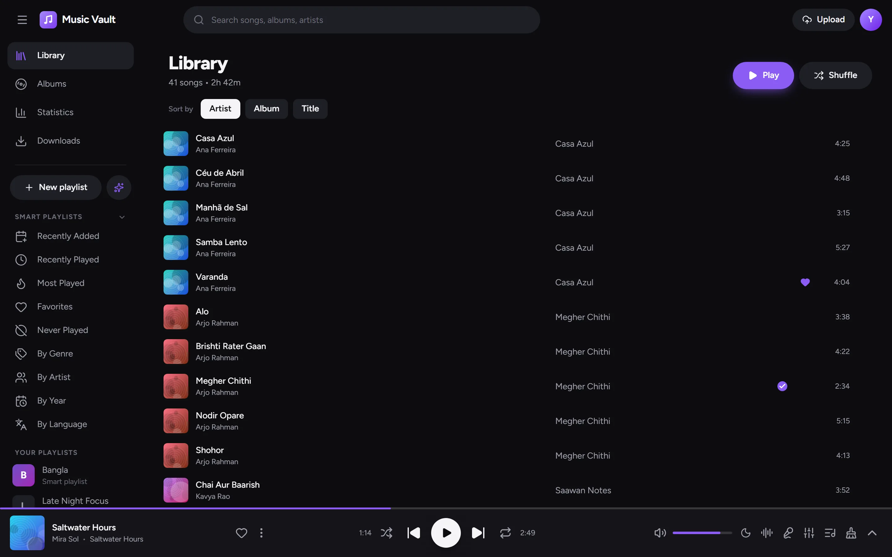
</picture>

The Android app: the library, the full player and statistics.

<p>
  <picture>
    <source media="(prefers-color-scheme: light)" srcset="docs/screenshots/android-library-light.webp">
    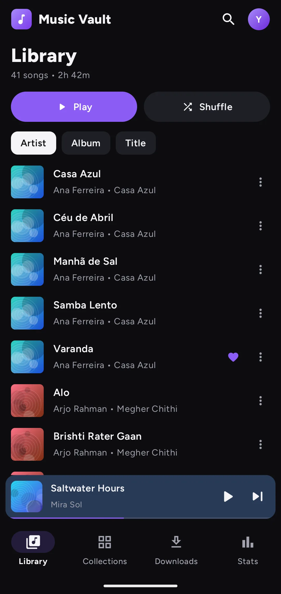
  </picture>
  <picture>
    <source media="(prefers-color-scheme: light)" srcset="docs/screenshots/android-now-playing-light.webp">
    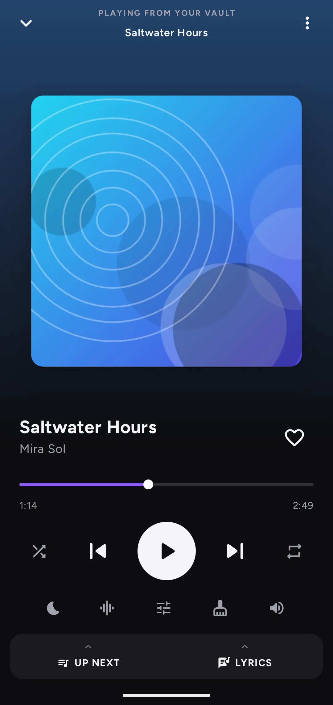
  </picture>
  <picture>
    <source media="(prefers-color-scheme: light)" srcset="docs/screenshots/android-statistics-light.webp">
    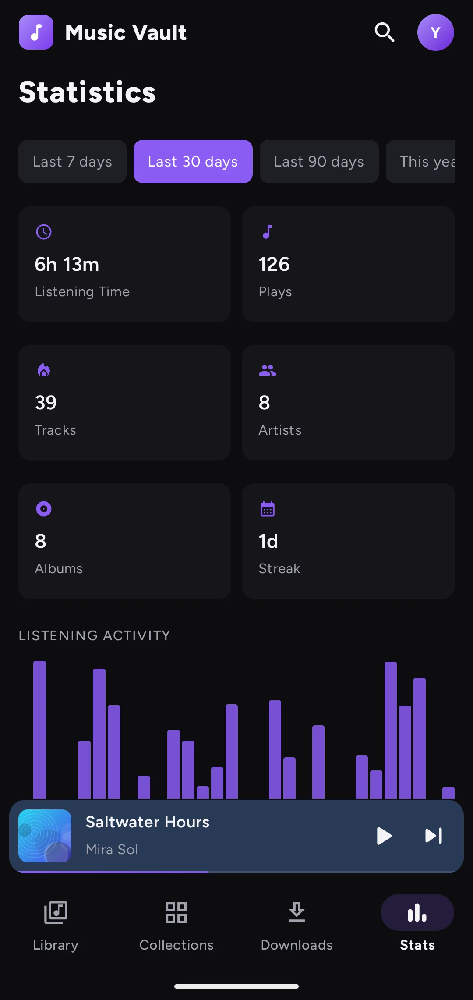
  </picture>
</p>

<details>
<summary><b>More screens: an album, the full player, statistics and downloads</b></summary>

An album page, with downloaded songs ticked.

<picture>
  <source media="(prefers-color-scheme: light)" srcset="docs/screenshots/album-light.webp">
  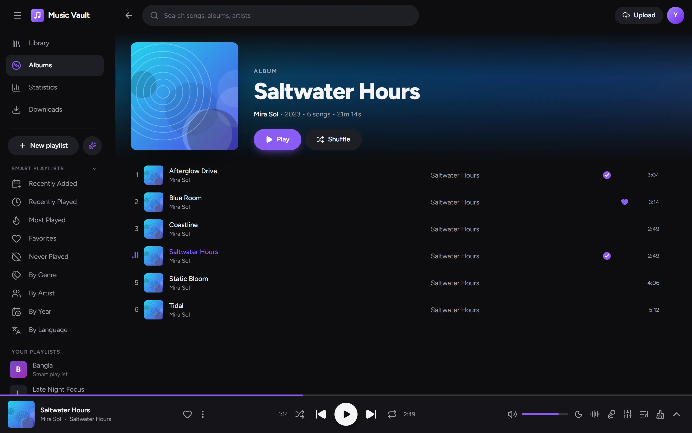
</picture>

The full player, with what plays next.

<picture>
  <source media="(prefers-color-scheme: light)" srcset="docs/screenshots/now-playing-light.webp">
  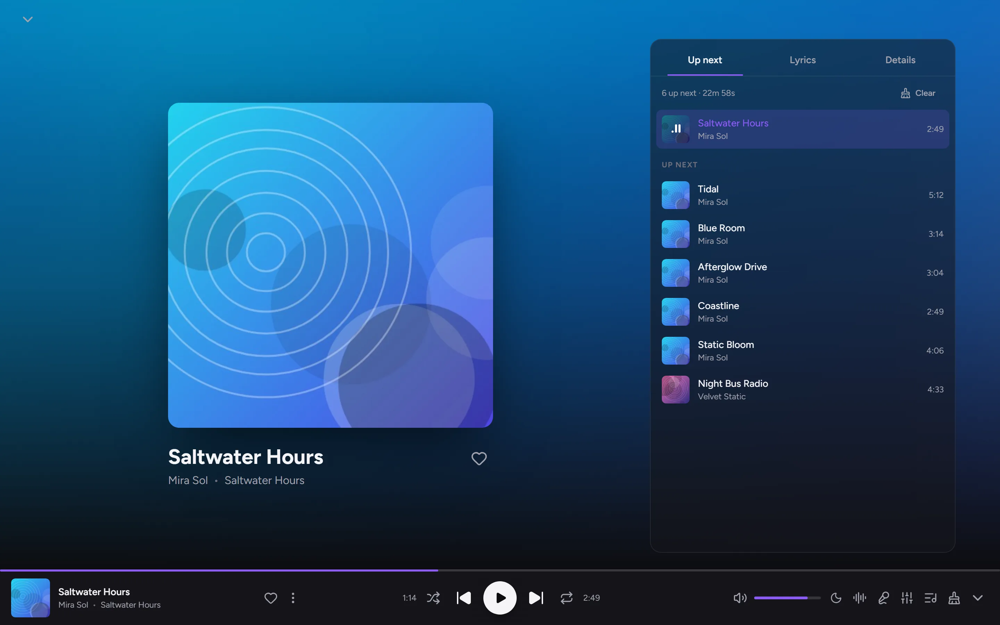
</picture>

Statistics: listening time, the activity chart and the last six months as a heatmap.

<picture>
  <source media="(prefers-color-scheme: light)" srcset="docs/screenshots/statistics-light.webp">
  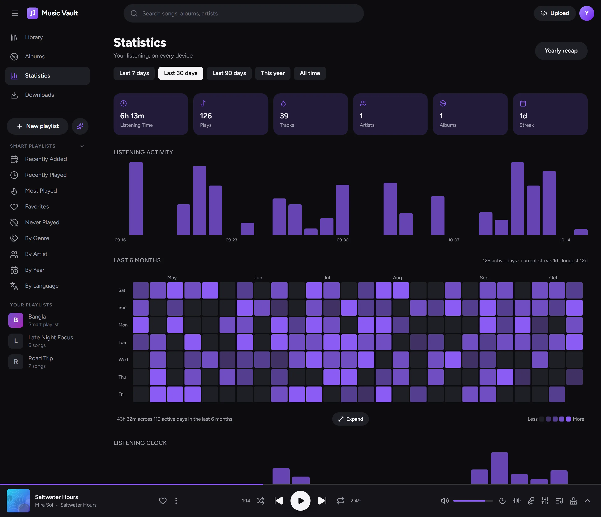
</picture>

Downloads: auto-download, the auto-cache limit and the songs kept on this device.

<picture>
  <source media="(prefers-color-scheme: light)" srcset="docs/screenshots/downloads-light.webp">
  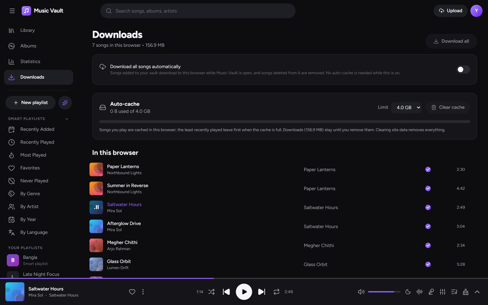
</picture>

On Android: an album and Downloads.

<p>
  <picture>
    <source media="(prefers-color-scheme: light)" srcset="docs/screenshots/android-album-light.webp">
    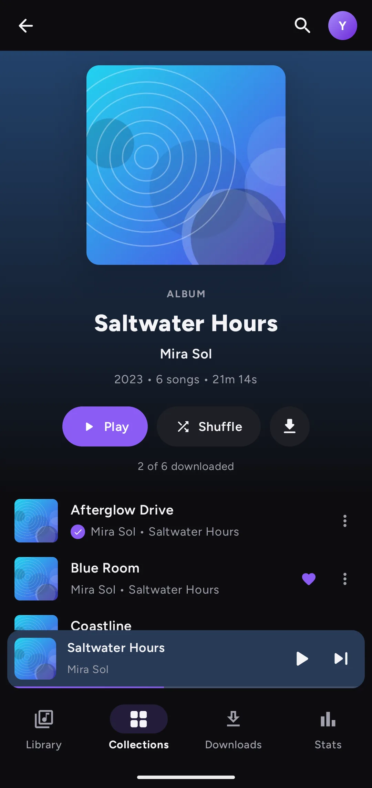
  </picture>
  <picture>
    <source media="(prefers-color-scheme: light)" srcset="docs/screenshots/android-downloads-light.webp">
    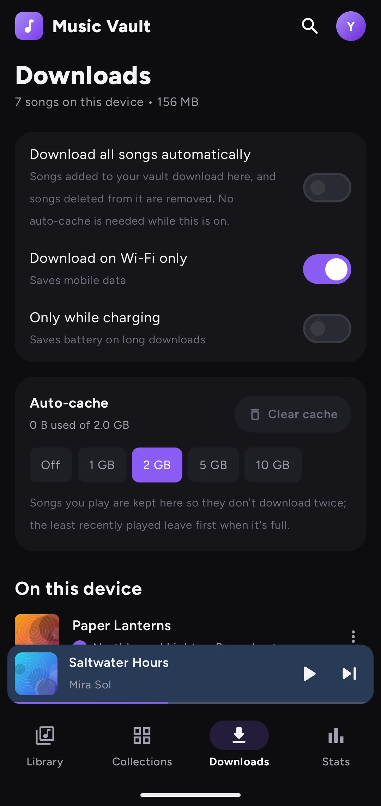
  </picture>
</p>

</details>

> **Every song, cover and number in these images is invented.** The Windows and web screens
> come from `npm run demo:shots -w music-vault-web`, which builds the web app with a made-up
> library ([apps/web/src/lib/demo.ts](apps/web/src/lib/demo.ts)) and no account. The Android
> screens come from `npm run android:demo-shots`, which builds a separate demo app with the
> same library ([DemoLibrary.kt](apps/android/app/src/main/java/com/musicvault/demo/DemoLibrary.kt))
> and captures it on an emulator. Both capture every screen in both themes.

## Features

**Library**
- Upload songs from any app: pick files (or drop them on the Windows and web windows, or share
  them to the Android app), review each song's details, then upload. Tags only pre-fill the form.
- Edit a song's details and cover online from any app, one song or several at once: title, artist,
  album, genre, language, country, release date and lyrics.
- Browse by song, album, artist, genre, year and language; search across all of them.
- Playlists with drag-and-drop ordering, favorites, and smart playlists: built-in ones (Recently
  Added, Most Played, Never Played…) and your own, built from rules.

**Playback**
- Windows: a Rust audio engine with gapless playback and crossfade, a 10-band equalizer,
  ReplayGain, FLAC, ALAC, APE, WavPack and the common lossy formats, a mini player, tray controls
  and Windows media keys.
- Android: background and lock-screen playback, notification and Android Auto controls, gapless
  and crossfade, the same equalizer, swipe between songs, and a volume slider on the full player.
- Web: plays in the browser and installs as an app (PWA) that opens offline.
- Everywhere: a queue with play next and add to queue, synced lyrics, a visualizer and a sleep
  timer.

**Offline**
- Songs you play are cached on the device (Off to 10 GB, with Clear cache), so nothing downloads
  twice.
- Download a song, album, artist or playlist to keep it; the button shows progress, cancels while
  running and removes the downloads once complete.
- "Download all songs automatically" keeps the whole vault on a device, including songs added
  later.
- Every download is checked against the song's BLAKE3 hash before it is kept.

**Statistics**
- Listening time, plays, streaks, an activity chart, the last six months as a heatmap (with your
  whole history a click away), a listening clock, and top artists, albums, genres and songs.
- A yearly recap on Windows and the web.

**Sync**
- Favorites, playlists, edits, the queue, settings and play history sync between your devices.
- Edits made offline wait in a queue and go up when you reconnect; the newest edit wins.

## How it works

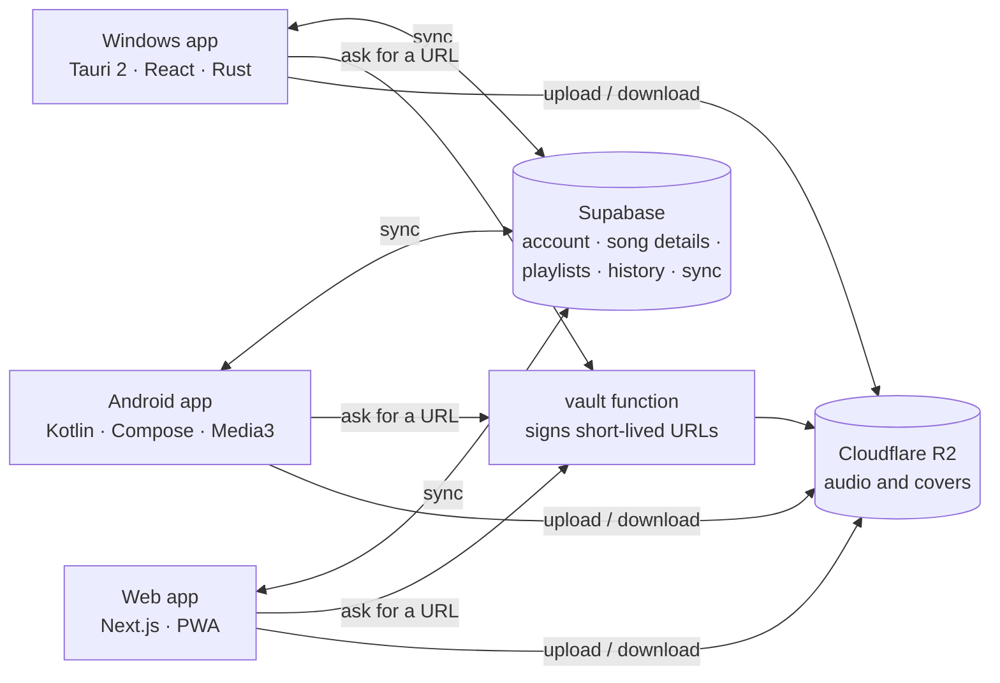

- **Supabase** holds the account, every song's details and the sync state, behind row-level
  security, so each account only ever sees its own rows.
- **The vault** is a private R2 bucket. Only the `vault` Edge Function holds its keys; the apps ask
  it for short-lived upload and download URLs.
- **Each app keeps a local copy** of the library and of the audio it has played or downloaded, so it
  starts instantly and works offline. Changes go into a local queue and sync in the background.
- **Shared code** keeps the apps in step: the sync engine, smart rules, statistics and track editing
  live in `packages/core` (TypeScript) with a Kotlin port for Android, and the same test fixtures
  check both.

More in [docs/architecture.md](docs/architecture.md) and
[docs/sync-protocol.md](docs/sync-protocol.md).

## Requirements

- **To run your own:** a free [Supabase](https://supabase.com) project, a
  [Cloudflare R2](https://www.cloudflare.com/developer-platform/products/r2/) bucket, and (for the
  web app) a [Vercel](https://vercel.com) account.
- **Windows app:** Windows 10 or 11. To build it: Node 20.19+ or 22.12+ (CI uses 22), Rust
  (stable, MSVC) and WebView2.
- **Android app:** Android 9 or later. To build it: JDK 17 and the Android SDK.
- **Web app:** a current browser; Chromium-based ones (Chrome, Edge) are the ones tested.

## Run your own

Music Vault has no shared server: each install runs on its owner's own free
Supabase project and Cloudflare R2 bucket. Setting one up takes these steps,
each with its own guide:

1. A Supabase project with the migrations
   ([docs/setup-supabase.md](docs/setup-supabase.md)).
2. An R2 bucket, its CORS rules and API token, and the `vault` Edge Function
   that signs its URLs ([docs/vault-setup.md](docs/vault-setup.md)).
3. The web app on Vercel ([docs/web-setup.md](docs/web-setup.md)).
4. The Windows and Android apps, built with your project's URL and anon key
   ([docs/setup.md](docs/setup.md)).

There are no prebuilt installers: a build carries the Supabase project it was
made for, so you build your own.

## Configuration

Every app is built with your Supabase project's URL and anon key. Only the `vault` function holds
real secrets. Copy a template, fill in your own values, and keep the result out of git (the
`.gitignore` already excludes these files).

| Part | Where the settings go | Settings |
|---|---|---|
| Windows app | `apps/desktop/.env`, from [.env.example](apps/desktop/.env.example) | `VITE_SUPABASE_URL`, `VITE_SUPABASE_ANON_KEY` |
| Web app | `apps/web/.env.local`, from [.env.example](apps/web/.env.example); on Vercel, the project's environment variables | `NEXT_PUBLIC_SUPABASE_URL`, `NEXT_PUBLIC_SUPABASE_ANON_KEY` |
| Android app | `apps/android/local.properties`, or environment variables | `supabase.url` / `SUPABASE_URL`, `supabase.anonKey` / `SUPABASE_ANON_KEY` |
| `vault` function | Supabase secrets | `R2_ACCOUNT_ID`, `R2_ACCESS_KEY_ID`, `R2_SECRET_ACCESS_KEY`, `R2_BUCKET` |

```properties
# apps/android/local.properties
supabase.url=https://your-project-ref.supabase.co
supabase.anonKey=your-anon-key
```

Every variable, what reads it and how exposed it is:
[reports/ENVIRONMENT_VARIABLES.md](reports/ENVIRONMENT_VARIABLES.md).

## Usage

1. **Create your account.** Choose Sign up in any of the apps, confirm the email, then sign in. The
   same email and password work on every device.
2. **Upload music.** Use the upload button, drop files on the Windows or web window, or share files
   to Music Vault on Android. Review each song's details before it uploads; the file's tags only
   pre-fill the form.
3. **Play.** Click a song to play it and queue what follows. The queue, lyrics and equalizer open from
   the player.
4. **Keep music offline.** Use Download on a song, album, artist or playlist, or switch on
   "Download all songs automatically" on the Downloads page.
5. **Organize.** Make playlists and drag songs to reorder them; smart playlists fill themselves
   from rules such as genre, language or play count.

The full user guide is the web app's Help page (`/help` on your deployment; source in
[apps/web/src/app/help/page.tsx](apps/web/src/app/help/page.tsx)).

## Development

```sh
npm install                                   # every JS workspace
npm run desktop:dev                           # Windows app, hot reload
npm run web:dev                               # web app on http://localhost:3000
cd apps/android && ./gradlew assembleDebug    # Android APK
```

```sh
npm run core:test                             # shared engine: sync conflicts, smart rules, stats, LRC
npm run desktop:test && npm run web:test      # app-level unit tests
npm run vault:test                            # the vault function
npm run desktop:build                         # the Rust tests embed the built frontend
# Rust: audio, cache, database. The skipped test plays a tone through your speakers.
cd apps/desktop/src-tauri && cargo test -- --skip plays_hires_tone_through_default_device
cd apps/android && ./gradlew testDebugUnitTest
npm run web:e2e                               # Playwright (E2E_EMAIL/E2E_PASSWORD for signed-in flows)
```

```sh
npm run tauri build -w music-vault-desktop    # Windows installer (NSIS), using apps/desktop/.env
```

Run each command from the repository root. The commands use `sh` syntax; on Windows, run them in
Git Bash or PowerShell 7. The web app is
built by Vercel when it deploys ([docs/web-setup.md](docs/web-setup.md)), and a signed release APK
is built locally with your own key ([apps/android/README.md](apps/android/README.md#release-apk)).

GitHub Actions run the tests on every push and pull request
([ci.yml](.github/workflows/ci.yml)). In a fork with your own Supabase secrets, running Release
builds by hand builds the Windows installer and a debug APK
([release.yml](.github/workflows/release.yml)).

```
apps/desktop     Windows app: Tauri 2, React 19, TypeScript, Tailwind, a Rust audio engine
apps/android     Android app: Kotlin, Jetpack Compose, Media3, Room
apps/web         Web app: Next.js 16
packages/core    Shared TypeScript: sync engine, vault client, uploads, smart playlists, statistics
supabase/        SQL migrations with row-level security, and the vault Edge Function
docs/            Setup guides, architecture and the sync protocol
reports/         Feature inventory, cross-platform parity, API, database, changelog
```

## Documentation

- [docs/README.md](docs/README.md): the index of every guide and report.
- [docs/setup.md](docs/setup.md): from zero to all three apps running.
- [reports/FEATURES.md](reports/FEATURES.md) and
  [reports/FEATURE_PARITY.md](reports/FEATURE_PARITY.md): what each app does, and where they
  differ.
- [reports/CHANGELOG.md](reports/CHANGELOG.md): what changed, release by release;
  [reports/PHASE_PROGRESS.md](reports/PHASE_PROGRESS.md) and [PLAN.md](PLAN.md) tell how the
  project was built.
- The web app's `/help` page is the user guide.

## Contributing

[Issues](https://github.com/naimulnashid/music-vault/issues) and small pull requests are welcome;
for anything larger, open an issue first. See [CONTRIBUTING.md](CONTRIBUTING.md).

## Security and privacy

- **Where your data lives.** Audio and covers are in your R2 bucket; song details, playlists,
  favorites, play history and sync state are in your Supabase project. No server run by this
  project sees any of it, and the apps contain no analytics or crash reporting.
- **Credentials.** The Supabase anon key is built into every app by design; row-level security,
  keyed to the signed-in account, is what protects the data. The R2 keys exist only as Supabase
  secrets read by the `vault` function, which gives the apps short-lived signed URLs. Each app keeps
  your sign-in session on the device (in cookies on the web).
- **On each device.** The apps keep a copy of your library and the audio they have cached or
  downloaded: in the app's data folder on Windows, app-private storage on Android and the
  browser's storage on the web. The apps don't encrypt these copies, so anyone with access to the
  device's files can play them.
- **Integrity.** Every download is checked against the song's BLAKE3 hash before it is kept.
- **Limitation: open sign-ups.** Any account on your Supabase project can upload into your bucket;
  the `vault` function has no allowlist or storage quota. Once your own account exists, turn off
  new-user sign-ups ([docs/setup-supabase.md](docs/setup-supabase.md#5-auth-settings-recommended)).
- **Reporting a vulnerability.** Report it privately; [SECURITY.md](SECURITY.md) has the process
  and what is in scope.

## License

[MIT](LICENSE)
