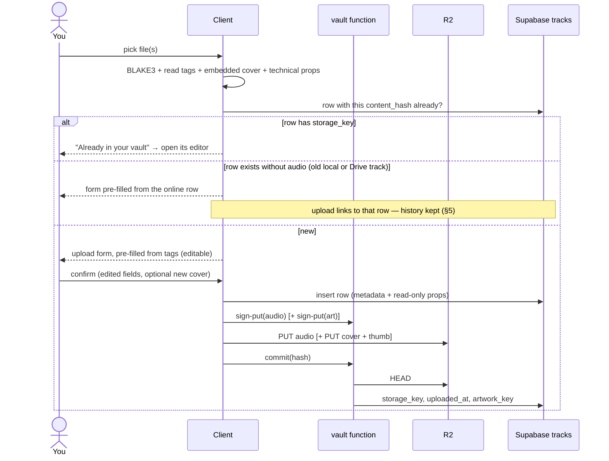

# Migration plan: replace Google Drive with Cloudflare R2

> Status: **complete** (M0–M8 done, M5 dropped; 2026-10-11 to 2026-10-13). Kept as the record of
> how Google Drive was replaced. Written 2026-10-11 against `main` @ `6941a11`, revised the same day
> with the owner's decisions (§1.1). For how the system works now, read
> [architecture.md](architecture.md) and [vault-setup.md](vault-setup.md).
> Goal: remove Google Drive from the project **entirely** and store audio in a private Cloudflare
> R2 bucket. Supabase becomes the single source of truth for all track metadata.

## 1. End state

- **Audio** lives in one private R2 bucket. Every object belongs to exactly one user and is
  named by the file's BLAKE3 content hash.
- **Metadata lives online, not in files or folders.** The Supabase `tracks` row is the source of
  truth for title, artist, album, year, genre, language and the rest. Tags embedded in a file are
  read **once**, at upload, as suggested starting values. After that, edits happen in the app and
  sync to every device. Folder names mean nothing.
- **Uploads are manual and work from every client.** You pick one or more files on desktop,
  Android or web, review or edit their metadata and cover, and upload. Nothing is ever uploaded
  automatically.
- **Metadata and covers are editable from every client.** Technical properties read from the
  audio itself (duration, codec, sample rate, bit depth, channels, file size, ReplayGain, content
  hash) are shown but **not editable**.
- **Audio files are immutable once uploaded.** Editing metadata or a cover never rewrites the
  audio, so its hash, and therefore its identity and every cached copy, never changes.
- **Identity** is the content hash alone. `drive_file_id`, `drive_md5`, `drive:<fileId>` ids,
  `drive://` URIs and the `Music Vault/<Language>/` folder convention are gone from every schema
  and every client.
- **Auth** is the existing Supabase login, nothing else. No Google Cloud project, no OAuth
  clients, no refresh tokens, no keyring entry, no `DRIVE_TOKEN_SECRET`.
- **The cloud library is the Supabase `tracks` table.** A track is "in the vault" when its row
  has a `storage_key`. Every client builds its library view from the sync shadow, which the web
  app already does today. There is no scanner and no merge of a second listing.
- **Local folders are retired.** Desktop folder import/watching and Android's SAF folder scanning
  are removed. The vault is the only library, and a file on disk is just something you upload.
  "Local mode" (running without an account) goes with it, because there would be no library to
  show. The library itself still works offline from the locally stored sync shadow.
- **Deleting from the vault works from every client**, behind a confirmation.
- **Unchanged:** the offline-first rule, the two-tier cache (auto-cache + pinned), "audio never
  streams twice", and the sync engine's conflict rules for favorites, ratings, playlists and
  history (§9).
- **Cost:** a library under 10 GB fits R2's free tier (10 GB-month storage, 1M writes,
  10M reads, free egress), so the expected bill is **$0/month**.

### 1.1 Owner decisions (2026-10-11)

| # | Question | Decision |
|---|---|---|
| 1 | What gets uploaded | **Nothing automatically.** Every upload is a manual action by the owner. |
| 2 | Where metadata comes from | **Stored and edited online.** File tags only pre-fill the upload form. No folder-derived values. All descriptive fields are editable, technical fields are not. Covers can be uploaded or replaced from the app. |
| 3 | Where the signing function runs | Supabase Edge Function. |
| 4 | The Drive copy afterwards | Kept untouched as a personal backup. No code reads it after M6. |
| 5 | Which clients upload | **All three:** desktop, Android and web. |
| 6 | Local-folder libraries | **Retired** on desktop and Android. |
| 7 | Who can delete from the vault | **Every client.** |
| 8 | The old library (decided after M4) | **Fresh start.** Nothing is brought over from Drive. On 2026-10-11 the Supabase data was wiped (tracks, playlists, favorites, ratings, play history, queue, settings, device registrations; only the account remains), and the library is rebuilt by uploading. M5's linking and import are dropped, and each app's M6 schema upgrade clears its local library. |

## 2. Target architecture

### 2.1 Storage layout

```
bucket: musicvault (private — no public access, no r2.dev URL)
  users/<supabase-user-id>/audio/<blake3-hex>.<ext>
  users/<supabase-user-id>/art/<sha256-hex>.jpg         full cover, ≤ 1200 px
  users/<supabase-user-id>/art/<sha256-hex>.thumb.jpg   256 px thumbnail
```

- **Audio** is content-addressed, so uploads are idempotent and identical files are stored once.
  The extension is kept so decoders that probe by hint (Symphonia, Media3) behave as they do with
  local files.
- **Covers** are content-addressed too, so one image shared by a whole album is stored once.
  Clients resize before upload (≤ 1200 px JPEG + 256 px thumb), so a cover costs a few hundred KB
  at most.

### 2.2 Schema (Supabase)

New on `public.tracks` (migration `0004_vault.sql`):

| Column | Type | Meaning |
|---|---|---|
| `storage_key` | `text` | Audio object key. `NULL` means the track is not in the vault. |
| `uploaded_at` | `timestamptz` | When the audio object was confirmed present. |
| `artwork_key` | `text` | Cover object key (`NULL` = no cover). The thumb key is derived from it. |
| `field_edited_at` | `jsonb` | Per-field edit clock, `{ "title": "<iso>", "language": "<iso>", … }`, used for field-level last-writer-wins (§2.5). |
| `deleted_at` | `timestamptz` | Tombstone. Track rows are never hard-deleted by the app, because a deletion is invisible to `updated_at` cursor pulls. Clients hide tombstoned tracks. |
| `merged_into` | `uuid` | On a tombstone left by a merge: the row that absorbed its history, so clients can remap local references (repointed play events are not re-pulled). |

`storage_key`, `uploaded_at`, `deleted_at` and `merged_into` are **protected**. A trigger ignores
client writes to them (role `authenticated`), so only the vault function (service role) and the
SQL functions below can set them, while existing client upserts keep working.

**Editable fields:** `title`, `artist`, `album`, `album_artist`, `genre`, `year`, `language`,
`composer`, `track_no`, `disc_no`, `bpm`, `lyrics_text`, `lyrics_synced`, `artwork_key`.

**Read-only fields** (set from the file at upload, never by an edit): `content_hash`,
`file_name`, `file_size`, `duration`, `codec`, `sample_rate`, `bit_depth`, `channels`,
`replaygain_track_db`, `replaygain_album_db`.

Also in `0004_vault.sql`:

- `apply_track_edit(track_id, patch jsonb, edited_at)`. Applies each field in `patch` only if
  `edited_at` is at least as new as that field's entry in `field_edited_at` (ties go to the
  incoming edit, as for the other LWW entities), in one statement. It rejects read-only fields,
  empty titles and cover keys outside the caller's prefix. Runs as the caller (RLS).
- `resolve_upload_target(content_hash, md5?)`. Called before an upload. It returns the row the
  upload attaches to: same hash (a tombstone is revived), else an old Drive row with the same md5
  that adopts the hash, merging the two when both exist. Returns null for a new song.
- `merge_tracks(keep, drop)`. Repoints favorites, ratings and playlist entries (newest
  `edited_at` wins), play events and the queue from one row to another. Identities carry over,
  and the duplicate becomes a tombstone with `merged_into`.
- `delete_track(track_id)`. Removes the track's favorites, ratings, playlist entries, play events
  and queue references, and tombstones the row, which keeps its hash so a re-upload revives it.
  It returns the object keys for the vault function to delete.

The three functions that change several tables are `security definer`. Each one checks
`auth.uid()` ownership itself.

Tests: `supabase/tests/vault_smoke.sql` (rolled back, two fake users) covers protected columns,
LWW, resolution, merge, delete and cross-user refusal.

Removed later (migration `0005_drop_drive.sql`, step M7): `drive_file_id`, `drive_md5`,
`tracks_user_drive_file_idx`, and the `tracks_identity` check, which is replaced by
`content_hash NOT NULL`.

### 2.3 The `vault` Edge Function

R2 keys must never ship inside an app, so a small Supabase Edge Function (Deno) holds them and
hands out **pre-signed URLs**. It is called with the user's normal Supabase JWT
(`supabase.functions.invoke` on desktop/web, the same HTTP call via OkHttp on Android).

| Action | Input | Checks | Returns |
|---|---|---|---|
| `sign-get` | `keys[]` (1–200, audio or art) | Each key is under `users/<auth.uid()>/` and referenced by one of the caller's live rows (a thumb counts via its full cover) | `{ urls: {key → url}, denied[] }`, valid 1 h |
| `sign-put` | audio: `trackId`, `ext` · art: `sha256`, `variant` (full/thumb), `size` | Audio key derived from the caller's own row's hash. Art key forced under the caller's prefix. Audio ≤ 2 GiB, art ≤ 5 MB | `{ key, url }`, valid 15 min |
| `commit` | `trackId`, `ext` | `HEAD` the object. Size must equal the row's `file_size`, otherwise the object is deleted | Sets `storage_key` + `uploaded_at` (and revives a tombstone) |
| `delete` | `trackId` | Ownership, via `delete_track` | Tombstones the row, then deletes the audio and any cover no other track uses |

Source: `supabase/functions/vault/` (`handler.ts` is pure and unit-tested by `handler.test.ts`,
`npm run vault:test`; `index.ts` wires Supabase + R2; `smoke.mjs` is the end-to-end check you
run while signed in).

- Signing uses the S3 API (`aws4fetch`) against `https://<account>.r2.cloudflarestorage.com`.
- Secrets live only in Supabase: `R2_ACCOUNT_ID`, `R2_ACCESS_KEY_ID`, `R2_SECRET_ACCESS_KEY`,
  `R2_BUCKET`. The R2 token is scoped to this one bucket.
- The bucket's CORS policy allows `GET` and `PUT` from the web app's origin only (web uploads,
  decision 5).

### 2.4 Upload flow (any client)



- **Multi-file:** selecting several files gives a batch form. Shared fields (album, artist,
  year, genre, language, cover) can be set once for the whole batch, then adjusted per track.
- **Background-safe:** desktop keeps a resumable upload queue in SQLite. Android runs each upload
  as a WorkManager job, so leaving the app doesn't cancel it. Web uploads while the tab is open
  and warns before closing mid-upload.
- **No tags at all?** The form starts with the file name as the title and everything else blank.
- **Autocomplete:** artist, album, genre and language fields suggest values already in your
  library, so grouping stays consistent ("Bangla" vs "Bengali").

### 2.5 Editing metadata and covers (any client)

- A **track editor** (single track) and a **multi-edit** (selected tracks, or "this album")
  expose the editable fields from §2.2. Read-only fields are displayed greyed out.
- **Cover:** choose an image, which is cropped to square and resized client-side. It can apply
  to one track or "all tracks in this album". Removing a cover is also an edit.
- **Sync:** an edit becomes a new sync op, `track.edit { track, patch, editedAt }`, in the
  existing outbox, so it works offline and flushes later. Flush calls `apply_track_edit`. Two
  devices editing **different** fields of the same track offline both keep their change. The same
  field resolves by last edit. Other devices receive the change through the normal `tracks` pull
  and Realtime hint.
- The TypeScript engine and its Kotlin port both gain the op, pinned by a new golden fixture
  (`docs/fixtures/track-edit.golden.json`), the same pattern used for smart rules and stats.

### 2.6 Playback (any client)

Unchanged resolution order: local file → pinned → auto-cache → download. A cache miss calls
`sign-get`, then downloads straight from R2 (Range supported). After download, the BLAKE3 of the
bytes is verified against the hash the file is named by. Desktop and Android already ship
BLAKE3; web adds `hash-wasm`, which it also needs for hashing uploads. Covers are fetched the same
way and kept in each client's existing artwork cache. That fixes the "no cover art for cloud-only
tracks" gap on Android and web as a side effect.

Because audio is immutable (§1), a cached copy can never go stale. The md5 change-detection
machinery (desktop SQLite v7 `source_md5`) is deleted rather than ported.

### 2.7 What must stop

Today the first device to download a Drive file **publishes the metadata from its tags** to
Supabase (`upsertRemoteTrack` on `drive://metadata-extracted`, Android `DownloadRepository`
finalize). Under the new model that would overwrite your edits, so **every
tag-to-Supabase publish path is removed**. The only time tags reach Supabase is the upload form
you confirm.

## 3. Inventory: what changes where

Counts are from `git grep -i drive` at `6941a11`: about 2,900 lines of dedicated Drive code across
114 source files.

### Server — `supabase/`
| Change | Files |
|---|---|
| Columns from §2.2, `apply_track_edit`, `merge_tracks` | new `migrations/0004_vault.sql` |
| `vault` Edge Function + Deno tests | new `supabase/functions/vault/` |
| Drop Drive columns/index, `content_hash NOT NULL` | new `migrations/0005_drop_drive.sql` (step M7) |
| RLS smoke test: another user's keys/rows are refused by both the function and `apply_track_edit` | `tests/rls_smoke.sql` |

### Shared core — `packages/core`
| Change | Files |
|---|---|
| Vault client (`signGet`, `signPut`, `commit`, `remove`) over `supabase.functions.invoke` | new `src/vault.ts` |
| Upload preparation shared by desktop + web: form model, editable/read-only field tables, batch defaults, cover resize rules | new `src/upload.ts`, `src/trackFields.ts` |
| `track.edit` op + flush + field-level LWW; golden fixture | `src/sync/{types,engine,transport}.ts`, `docs/fixtures/track-edit.golden.json` |
| `TrackRef`: drop `driveFileId`. `trackRefKey(s)` become hash/remote only. `getTrackByIdentity(contentHash)`. `insertTrack` conflict target `user_id,content_hash` | `src/sync/{types,transport,engine}.ts` (step M7) |
| Regenerated types | `src/supabase/database.types.ts`, `src/supabase/tracks.ts` |
| Tests: new edit-conflict cases. Drive-identity cases rewritten as hash cases | `tests/syncEngine.test.ts` |
| Spec update | `docs/sync-protocol.md` |

### Desktop — `apps/desktop`
| Change | Files |
|---|---|
| **New** uploader: file picker + drag-and-drop onto the window, resumable queue (SQLite), bounded concurrency, progress events | `src-tauri/src/vault/upload.rs`, `commands/vault.rs` |
| **New** UI: upload form (single + batch), track editor, multi-edit, cover picker/cropper, upload progress in Downloads | `components/{UploadDialog,TrackEditor,CoverPicker}.tsx` |
| Tag + cover + technical-property reading for upload, reusing `scan/tags.rs` (lofty) and `scan/hash.rs` (BLAKE3) | `vault/upload.rs` |
| **Delete** OAuth, Drive REST, scanner, artwork backfill | `src-tauri/src/drive/{auth,api,scanner,artwork,mod}.rs`, `commands/drive.rs` |
| **Keep and move** the two-tier cache, re-keyed by content hash. `source_md5` dropped | `drive/cache.rs` → `vault/cache.rs` |
| Downloader: pre-signed URL in, BLAKE3 verify instead of md5. Same per-file lock, bounded concurrency and progress events (`vault://…`). **No metadata publish** (§2.7) | `drive/download.rs` → `vault/download.rs` |
| SQLite v9: drop `drive_files`, `drive_folders`. Re-key `cache_entries` to the hash. `drive_artwork` → `cloud_artwork` keyed by `artwork_key`. Rewrite `drive:<fileId>` ids in `playlist_tracks`, `play_events`, `sync_outbox` | `src-tauri/src/db/{mod,queries,models}.rs` |
| Library view: vault tracks from the sync shadow (online metadata wins over local tags when the same hash is also a local file). Id `vault:<hash>` | `store/libraryStore.ts`, `store/syncStore.ts` |
| **Delete** | `store/driveStore.ts`, `lib/driveMerge.ts`, `lib/driveResolver.ts` (→ `lib/vaultResolver.ts`) |
| UI cleanup: Drive section out of `AccountMenu`. "Sync to this device" and Downloads read from the vault | `components/{AccountMenu,DownloadsView,DownloadAllButton,TrackList,NowPlayingBar,Sidebar}.tsx`, `lib/ipc.ts`, `main.tsx` |
| **Delete from vault** on track context menu and multi-select, with confirm | `components/TrackList.tsx`, `store/libraryStore.ts` |
| **Retire local folders:** remove folder import, the watcher and the duplicates view (identical files can no longer exist twice in the vault). `scan/tags.rs`, `scan/hash.rs` and `scan/artwork.rs` stay, reused by the uploader. SQLite: drop `watched_folders` and the local `tracks` table once the library reads from the shadow | `src-tauri/src/scan/{mod,watcher}.rs`, `commands/library.rs`, `components/DuplicatesView.tsx`, `db/mod.rs` |
| Require sign-in: remove the local-mode path (no Supabase env → app explains the account is required) | `main.tsx`, `store/authStore.ts`, `.env.example` |
| Crates removed if nothing else uses them after deletion: `keyring`, `md-5`, `sha2`, `base64`, `rand`, `url`, `open`, `notify`, `walkdir` (checked by `cargo build`, not assumed) | `src-tauri/Cargo.toml` |
| Env: remove `VITE_GOOGLE_CLIENT_ID/SECRET` | `.env.example` |

### Android — `apps/android`
| Change | Files |
|---|---|
| **New** uploader: system file picker (`OpenMultipleDocuments`) **and** "Share → MusicVault" from other apps. Each upload is a WorkManager job. Tags via JAudioTagger, BLAKE3 via the existing library | new `data/vault/{UploadRepository,UploadWorker}.kt`, `AndroidManifest.xml` (share intent filter) |
| **New** UI: upload sheet (single + batch), track editor, multi-edit, cover picker (Photo Picker + crop) | new `ui/{UploadSheet,TrackEditorScreen,CoverPicker}.kt` |
| `track.edit` op in the Kotlin sync port + golden test | `data/sync/*.kt`, `test/.../TrackEditGoldenTest.kt` |
| **Delete** | `data/drive/{DriveAuth,DriveApi,DriveScanner,DriveRepository,DriveMerge}.kt`, `ui/{DriveSection,DriveViewModel}.kt` |
| **Keep and move** to `data/vault/`: download worker, download repository (finalize **no longer publishes tags**, §2.7), audio cache | `data/drive/{DownloadWorker,DownloadRepository,AudioCache}.kt` |
| `DriveDataSource` → `VaultDataSource`: `vault://<hash>` → pinned file, else `CacheDataSource` over a pre-signed URL. Media3 cache key = hash | `playback/DriveDataSource.kt`, `VaultPlayer.kt` |
| Library view from the sync shadow (`RemoteTrackIndex`), id `vault:<hash>`, uri `vault://<hash>`. Covers fetched by `artwork_key` | `data/sync/RemoteTrackIndex.kt`, `data/repo/LibraryRepository.kt` |
| Room v7: drop `drive_files`, `drive_folders`, `TrackEntity.driveFileId`. Rewrite `drive:` ids/URIs in `tracks`, `playlist_tracks`, `play_history`, `queue_items`, `play_events`, `downloads`, `sync_outbox` | `data/db/{Entities,Daos,MusicVaultDatabase}.kt` |
| **Delete from vault** on track long-press menu and multi-select, with confirm | `ui/components/TrackList.kt`, `data/repo/LibraryRepository.kt` |
| **Retire local folders:** remove the SAF folder picker and `LibraryScanner`. `TagParser` and `ArtworkStore` stay, reused by the uploader. Room `tracks` becomes a mirror of the sync shadow only | `data/scanner/LibraryScanner.kt`, `ui/VaultDrawer.kt`, settings screens |
| Require sign-in: remove the local-mode path | `MusicVaultApp.kt`, auth screens |
| Remove AppAuth, `security-crypto` (Drive-only), the `GOOGLE_ANDROID_CLIENT_ID` build field and the `appAuthRedirectScheme` placeholder | `app/build.gradle.kts`, `gradle/libs.versions.toml`, `AndroidManifest.xml` |

### Web — `apps/web`
| Change | Files |
|---|---|
| **New** uploader: file input + drag-and-drop. BLAKE3 via `hash-wasm`, tags + cover via `music-metadata` (already a dependency), PUT straight to R2 | new `src/lib/upload.ts`, `src/store/uploadStore.ts` |
| **New** UI: upload dialog (single + batch), track editor, multi-edit, cover picker/cropper (shared design with desktop) | new `components/{UploadDialog,TrackEditor,CoverPicker}.tsx` |
| **Delete** all six Drive routes and the server token code | `src/app/api/drive/**`, `src/lib/server/{drive,tokenCrypto}.ts` |
| **Delete** | `src/lib/driveMerge.ts`, `src/lib/driveTypes.ts`, `src/store/driveStore.ts` |
| Audio cache fetches pre-signed URLs straight from R2 (no proxy). OPFS/IndexedDB keyed by remote track id as today. BLAKE3 verify. Covers by `artwork_key` instead of extraction on first download | `src/lib/{audioCache,artwork}.ts`, `src/hooks/useAudioEngine.ts` |
| IndexedDB upgrade: rewrite pinned `drive:` entries, drop auto-cache `drive:` entries | `src/lib/db.ts` |
| **Delete from vault** on track context menu and multi-select, with confirm | `components/TrackList.tsx`, `store/libraryStore.ts` |
| UI and copy | `components/{AccountMenu,DownloadsView,DownloadAllButton,TrackList,Sidebar,MusicVaultApp}.tsx`, `app/help/page.tsx`, `proxy.ts` |
| Env: remove `GOOGLE_CLIENT_ID/SECRET`, `DRIVE_TOKEN_SECRET` | `.env.example`, Vercel project settings |

### CI, docs
| Change | Files |
|---|---|
| Remove Google secrets from release builds | `.github/workflows/release.yml` |
| **Delete** | `docs/google-drive-setup.md`, `reports/GOOGLE_DRIVE.md` |
| `docs/vault-setup.md` (written at M0: Cloudflare bucket, token, CORS, Supabase secrets) gains a "deploying the function" section | `docs/vault-setup.md` |
| Update (incl. removing "local mode" from setup) | `README.md`, `PLAN.md`, `docs/{architecture,setup,web-setup,sync-protocol,README}.md`, `apps/web/src/app/help/page.tsx` (user docs: uploading and editing), every `reports/*.md` that mentions Drive |

## 4. Migration order

Drive is only ever **read** (the scope is `drive.readonly`), so the Drive copy of the library
stays intact throughout. Until step M7 everything is reversible by reinstalling the previous
build.

```mermaid
graph LR
    M0[M0 Cloudflare +<br/>Supabase setup] --> M1[M1 Server:<br/>schema + function]
    M1 --> M2[M2 Core: vault client<br/>+ track.edit op]
    M2 --> M3[M3 Upload + edit<br/>on all 3 clients]
    M3 --> M4[M4 Play from the vault<br/>on all 3 clients]
    M4 --> M5[M5 Bring over what<br/>you want from Drive]
    M5 --> M6[M6 Delete Drive +<br/>local-folder code]
    M6 --> M7[M7 Drop Drive columns<br/>⚠ point of no return]
    M7 --> M8[M8 Docs + revoke<br/>Google OAuth]
```



| Step | Work | Done when |
|---|---|---|
| **M0** — you | Create the Cloudflare account and the private `musicvault` bucket. Create an R2 API token limited to that bucket. Set CORS for the web origin. Store the four secrets in Supabase. | `supabase secrets list` shows the four R2 values |
| **M1** | `0004_vault.sql`, `vault` Edge Function with unit tests, `vault_smoke.sql`, `smoke.mjs` | `node supabase/functions/vault/smoke.mjs` passes for your account: upload, commit, download, range, foreign key refused, CORS, cover, LWW edit, delete |
| **M2** | `vault.ts`, `upload.ts`, `trackFields.ts`, `track.edit` op in the TS engine **and** the Kotlin port, golden fixture | `npm run core:test` and Android `testDebugUnitTest` green, including the new fixture |
| **M3** | Upload form, track editor, multi-edit and cover picker on **desktop, web, Android** (one sub-step per client: M3a desktop, M3b web, M3c Android). Each sub-step also brings that client's M4 *library* work forward — vault tracks listed from the sync shadow, online edits overlaid, vault playback and covers — because an upload you can't see or play can't be checked. **M3a done 2026-10-11. M3b done 2026-10-11. M3c done 2026-10-11** (checked on the Pixel 9 emulator: upload, edit, multi-select, delete from vault, vault playback; Android pinned vault downloads move to M4). | From each client: upload a tagged file, an untagged file and a batch. Edit a field and a cover. See the change arrive on the other two |
| **M4** | All three clients play vault tracks (library from the sync shadow, pre-signed downloads, BLAKE3 verify, covers by key). Local id-rewrite migrations (SQLite v9, Room v7, IndexedDB upgrade). Tag-publish paths removed (§2.7). Drive code still present but unused for playback. **M4 code done 2026-10-11** (see §5.4 "As built"); Android pinned vault downloads added. Android checked on the Pixel 9 emulator (pin, offline play, cover after cache clear, id rewrite of seeded `drive:` rows); desktop and web to be checked by the owner | Each client plays a cloud-only track and shows its cover after its cache is cleared, with Drive disconnected |
| ~~M5~~ | **Dropped (decision 8):** fresh start, no import. Uploading is ongoing and separate from the app work | — |
| **M6** | Delete all Drive code, dependencies, env vars, CI secrets. Retire local folders and local mode on desktop and Android. Each app's schema upgrade (SQLite v9, Room v7, IndexedDB v2) also **clears its local library** (playlists, history, caches, sync state), because the server was wiped (decision 8). Drop the MD5 linking from uploads. Rebuild installer + APK + web. **M6 done 2026-10-11** (Android upgrade checked on the emulator) | `git grep -i "google drive\|drive_file_id\|driveFileId"` returns only migration history. No folder import UI remains. All three apps build |
| **M7** ⚠ | Run only after **every device** has the M6 build and its outbox is empty. No review list is needed: the server was wiped (decision 8). Then `0005_drop_drive.sql` (also dropping `drive_md5`). **M7 done 2026-10-11:** applied live; `resolve_upload_target` still accepts `p_md5` and ignores it so M6 builds keep uploading; live sync round trip (phone → server → phone) checked on the emulator, and core + Kotlin `TrackRef` lose `driveFileId` | Core, Rust and Android test suites green. A sync round-trip between two devices works |
| **M8** | Write the new docs, delete the Drive docs. **You** delete the Google Cloud OAuth clients (or the whole project). The Drive folder stays as your backup. **M8 docs done 2026-10-13:** README, `docs/` and every report describe the vault; `reports/VAULT.md` replaces `reports/GOOGLE_DRIVE.md` and `docs/google-drive-setup.md`; Drive is mentioned only as history. Deleting the Google Cloud OAuth clients and the unused Vercel variables is left to you | No Drive references left in `docs/` or `reports/` |

Each step is its own commit (or small series) on `main`, with the desktop installer rebuilt
whenever desktop code changes.

## 5. Your existing library (M5)

> **Superseded by decision 8 (fresh start).** The server data was wiped on 2026-10-11 and nothing is
> imported. §5.1–5.3 below are kept for the record only, and so is §5.4: the id rewrite it describes
> shipped in M4 and was removed again in M6, once no Drive ids could exist.

Nothing is uploaded on your behalf. Your current Supabase rows hold the ratings, favorites,
playlist entries and play history of both your Drive tracks and your local-folder tracks.

**Local-folder tracks** already have a row keyed by their BLAKE3 hash. Uploading the same file
from any client finds that row by hash and links to it (§2.4), so its history is kept with no
extra step.

**Drive tracks** usually have no hash on record, so there are two ways to bring one over, and
both keep its history attached:

### 5.1 Re-upload it yourself (any client, any time before M7)
When you upload a file, the client also computes its **MD5** and asks whether an old Drive row
has the same `drive_md5`. Drive recorded that MD5 for every file, so the match is exact. On a
match, the upload **links to the old row** instead of creating a new one. Your history comes
along, and the form pre-fills with the metadata already online. If a separate local-copy row with
the same hash also exists, the two are combined with `merge_tracks`. This MD5 step disappears at
M7.

### 5.2 Optional: "Import from Drive" (desktop, you start it)
A one-time screen listing every Drive file with checkboxes ("select all" available). Only what
you tick is downloaded, hashed, linked to its old row as in §5.1, and uploaded. If a file's tags
have no language, the old folder name is offered as a **suggestion in the form**, never applied
silently. The import is resumable and is deleted with the rest of the Drive code at M6.

### 5.3 Tracks you never bring over
Before M7 runs, every row still without audio in the vault (old Drive or local-folder tracks) is
listed: title, artist, plays, rating, and which playlists use it. Those rows are then deleted,
because no client can play them any more and Drive rows lose their only identity. Nothing is
deleted without you seeing that list first.

### 5.4 Local id rewrite (M4, per client)
Server data references track **UUIDs** and needs no rewrite. Only device-local stores hold
`drive:<fileId>` ids. Each client's first launch on the M4 build:

1. Pulls `tracks`, which still carry `drive_file_id`, and builds `fileId → row`.
2. Rewrites local ids and URIs to `vault:<hash>` / `vault://<hash>` for rows that are already in
   the vault. Rows not yet brought over keep their `drive:` id until M7 removes them. The same
   applies to `TrackRef`s in the pending outbox. All in one transaction.
3. Renames nothing on disk. Cached files keep their paths; only their index keys change.
4. Rebuilds its `tracks` shadow with a full pull. That drops any row hard-deleted on the server
   before tombstones existed (for example the M1 smoke test's temporary row, if a client happened
   to pull it), and picks up `deleted_at` / `merged_into` on every row.

As built (M4): the rewrite runs whenever track rows change, not only on first launch, because
Drive tracks reach the vault one by one during M5 (it is idempotent, and cheap once done). A Drive
track whose audio is in the vault is shown under its vault id from then on. A cached or pinned
Drive copy is kept as the vault copy only if its BLAKE3 matches the vault hash; otherwise it is
dropped and downloads again from the vault. The outbox is not rewritten: its `TrackRef`s are
identities (remote id, Drive id, hash) rather than local ids, and keep resolving until M7, which is
gated on an empty outbox anyway. Web needed no id rewrite (its ids are already the rows' UUIDs);
its cache records each vault copy's hash and refetches a copy that doesn't match. No schema
version bump was needed for M4. SQLite v9 and Room v7 come with M6, when the Drive tables go.
Every client already does a full pull at startup; that pull now prunes the tracks shadow.
Two fixes came out of testing M4. A re-upload of a deleted track now sends its edits (a changed
cover, for example) only after the commit revives the row; before, they were dropped. And when a
track is deleted from the vault, on this device or another, each client drops its cached or
pinned copy. Rows a client hasn't pulled never count, so an empty shadow can't wipe downloads.

## 6. Open questions

None. Local folders are retired and delete works from every client (§1.1, decisions 6–7).
"Delete from vault" removes the audio object and tombstones the row, and with it goes that track's ratings,
favorites, playlist entries and play history. The confirmation says so.

## 7. Risks

| Risk | Mitigation |
|---|---|
| Edits on two devices collide | Field-level LWW (`apply_track_edit`), pinned by a golden fixture in both engines |
| A download path republishes tags over your edits | §2.7 removes every tag-to-Supabase path. A sync test asserts a download never writes `tracks` |
| A device still on an old build after M7 can't resolve Drive-only refs | M7 is gated on every device running M6 with an empty outbox. Old builds only lose sync, not local data |
| Losing history of old Drive tracks | MD5 linking (§5.1), the optional import (§5.2), and the review list before any deletion (§5.3) |
| Large uploads on mobile data | Android upload jobs honour the existing Wi-Fi-only download preference (also applied to uploads) |
| R2 keys leak | Keys exist only as Supabase secrets. Token scoped to one bucket. URLs expire |
| Free tier exceeded | At 10+ GB storage costs $0.015/GB-month, e.g. 20 GB is about $0.15/month. Operations stay far below the free limits |
| Android path never verified on a device (true of Drive today too) | M3c/M4 done-when require a real-device check, the same as the open Phase 6 item |

## 8. Out of scope

- Sharing or multi-user libraries.
- Replacing a track's audio with a different file (e.g. a better rip). Today that is upload the new
  one, then delete the old one. A "replace audio, keep history" action can follow later.
- Writing edited metadata back into the audio files. They stay as uploaded. The online row is the
  truth, and exporting tagged files could be a later feature.
- Any provider other than R2. The vault function is the only place that knows it's R2, so a
  later swap touches one function, not three clients.

## 9. Not changing

- Smart playlists, grouped browsing, stats and recap already read these same fields. They now
  read the online values, so grouping and sorting follow your edits everywhere.
- Ratings, favorites, playlists, queue handoff and play history sync exactly as today.
