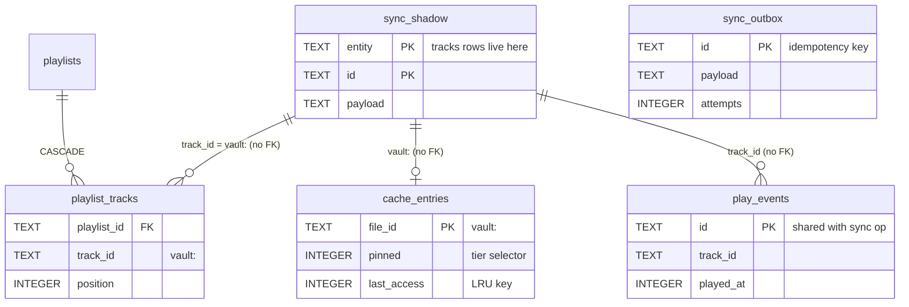

# Database Reference

> Audit date: 2026-07-17 · branch `main` @ `e3b5237`; updated 2026-10-13 for the vault
> (migrations 0004–0005, desktop SQLite v9, Room v7).
> Four persistence layers are documented here: **Supabase PostgreSQL** (the cloud),
> **desktop SQLite**, **Android Room**, and **web IndexedDB/OPFS**. Every column below was read
> from the cited file. Related: [API.md](API.md) · [VAULT.md](VAULT.md) ·
> [ARCHITECTURE_DECISIONS.md](ARCHITECTURE_DECISIONS.md).

## The governing rule

Supabase stores **track details and user state only**. Audio and cover bytes live in the R2
vault ([VAULT.md](VAULT.md)); this database records where (`storage_key`, `artwork_key`) and owns
every track's details, which are edited online
([0004_vault.sql:1-5](../supabase/migrations/0004_vault.sql)).

The local databases follow the same rule: downloaded audio lives on the filesystem (desktop
`audio-cache/` + `downloads/`, Android files dir, web OPFS); the databases hold only bookkeeping.
No client keeps its own copy of the track list — each projects the synced `tracks` rows.

---

# 1. Supabase (PostgreSQL)

## 1.1 Migration history

| # | File | Lines | Phase | What it does |
|---|---|---:|---|---|
| 0001 | [0001_init.sql](../supabase/migrations/0001_init.sql) | 277 | 1 | Full initial schema: 9 tables, RLS on all of them, `set_updated_at()` + `handle_new_user()` triggers |
| 0002 | [0002_track_identity_upsert.sql](../supabase/migrations/0002_track_identity_upsert.sql) | 11 | 3 | Replaces the two *partial* unique indexes on `tracks` with full ones so PostgREST can infer upsert conflict targets |
| 0003 | [0003_sync.sql](../supabase/migrations/0003_sync.sql) | 89 | 4 | Adds `edited_at` (client LWW clock) + soft-delete state, converts favorites/ratings from hard deletes, adds `play_events.created_at`, adds 8 tables to the Realtime publication |
| 0004 | [0004_vault.sql](../supabase/migrations/0004_vault.sql) | 354 | vault M1 | Vault columns on `tracks` (`storage_key`, `uploaded_at`, `artwork_key`, `field_edited_at`, `deleted_at`, `merged_into`), the protected-column trigger, and `apply_track_edit`, `merge_tracks`, `resolve_upload_target`, `delete_track` |
| 0005 | [0005_drop_drive.sql](../supabase/migrations/0005_drop_drive.sql) | 131 | vault M7 | Drops `drive_file_id` / `drive_md5` and their indexes; identity becomes the content hash alone; re-creates `merge_tracks` and `resolve_upload_target` without Drive |

There is **no migration runner in the repo** — no Supabase CLI config, no `supabase/config.toml`.
The migrations are applied by hand (the RLS test says "run in the Supabase SQL editor (or psql)"
— [tests/rls_smoke.sql:1-3](../supabase/tests/rls_smoke.sql)). See
[BUILD_AND_RUN.md](BUILD_AND_RUN.md#supabase).

### Why 0002 exists
PostgREST cannot infer partial unique indexes for upsert, so 0002 made the identity indexes full
ones. The `(user_id, content_hash)` index it created is still the upsert conflict target
([0002_track_identity_upsert.sql](../supabase/migrations/0002_track_identity_upsert.sql)).

### Why 0003 exists — the two-timestamp scheme
- `updated_at` — set by a **server** trigger → drives **pull cursors**.
- `edited_at` — supplied by the **client** → resolves **last-writer-wins** conflicts.

Stated at [0003_sync.sql:1-6](../supabase/migrations/0003_sync.sql). It also converts deletions to
soft state, because "deletions are invisible to `updated_at` cursors"
([0003_sync.sql:9-11](../supabase/migrations/0003_sync.sql)).

## 1.2 ER diagram

```mermaid
erDiagram
    auth_users ||--|| profiles : "1:1 (trigger-created)"
    auth_users ||--o{ devices : owns
    auth_users ||--o{ tracks : owns
    auth_users ||--o{ playlists : owns
    auth_users ||--|| queue_state : "1:1"
    playlists ||--o{ playlist_items : contains
    playlists ||--o{ playlists : "parent_id (folders)"
    tracks ||--o{ playlist_items : "referenced by"
    tracks ||--o{ favorites : "0..1 per user"
    tracks ||--o{ ratings : "0..1 per user"
    tracks ||--o{ play_events : "append-only"
    tracks ||--o{ tracks : "merged_into"
    devices ||--o{ play_events : "recorded on"
    devices ||--o| queue_state : "last writer"

    profiles {
        uuid id PK_FK
        text display_name
        timestamptz created_at
        timestamptz updated_at
    }
    devices {
        uuid id PK
        uuid user_id FK
        text name
        text platform "desktop|android|web"
        timestamptz created_at
        timestamptz last_seen_at
    }
    tracks {
        uuid id PK
        uuid user_id FK
        text content_hash "BLAKE3, unique per user"
        text storage_key "R2 audio object"
        text artwork_key "R2 cover object"
        jsonb field_edited_at
        timestamptz deleted_at "tombstone"
        uuid merged_into FK "self"
        text file_name
        text title
        real duration
        jsonb lyrics_synced
        timestamptz updated_at
    }
    playlists {
        uuid id PK
        uuid user_id FK
        uuid parent_id FK "self"
        text name
        boolean is_folder
        boolean is_smart
        jsonb smart_rules
        text position "fractional index"
        timestamptz edited_at
        timestamptz deleted_at
    }
    playlist_items {
        uuid id PK
        uuid playlist_id FK
        uuid track_id FK
        text position "fractional index"
        timestamptz deleted_at
    }
    favorites {
        uuid user_id PK_FK
        uuid track_id PK_FK
        boolean favorite "soft state"
        timestamptz edited_at
    }
    ratings {
        uuid user_id PK_FK
        uuid track_id PK_FK
        smallint rating "0-5, 0=cleared"
        timestamptz edited_at
    }
    play_events {
        uuid id PK "CLIENT-generated"
        uuid user_id FK
        uuid track_id FK
        uuid device_id FK
        timestamptz played_at "client clock"
        timestamptz created_at "server clock"
        real duration_played
        boolean completed
    }
    settings {
        uuid user_id PK_FK
        text scope PK "global|<device id>"
        text key PK
        jsonb value
        timestamptz edited_at
    }
    queue_state {
        uuid user_id PK_FK
        uuid device_id FK
        jsonb track_ids
        int current_index
        real position_seconds
        boolean shuffle
        text repeat "off|one|all"
    }
```

## 1.3 Tables

### `profiles` — [0001_init.sql:19-51](../supabase/migrations/0001_init.sql)

| Column | Type | Constraints |
|---|---|---|
| `id` | uuid | **PK**, FK → `auth.users(id)` ON DELETE CASCADE |
| `display_name` | text | |
| `created_at` | timestamptz | NOT NULL DEFAULT `now()` |
| `updated_at` | timestamptz | NOT NULL DEFAULT `now()`, maintained by trigger `profiles_updated_at` |

Rows are created automatically by the `handle_new_user()` `security definer` trigger on
`auth.users` insert, defaulting the name to the signup metadata's `display_name` or the email
local-part ([:36-51](../supabase/migrations/0001_init.sql)).
**RLS**: `id = auth.uid()` for all operations.

### `devices` — [0001_init.sql:55-69](../supabase/migrations/0001_init.sql)

| Column | Type | Constraints |
|---|---|---|
| `id` | uuid | **PK** DEFAULT `gen_random_uuid()` |
| `user_id` | uuid | NOT NULL, FK → `auth.users(id)` CASCADE |
| `name` | text | NOT NULL |
| `platform` | text | NOT NULL, **CHECK** in `('desktop','android','web')` |
| `created_at` | timestamptz | NOT NULL DEFAULT `now()` |
| `last_seen_at` | timestamptz | NOT NULL DEFAULT `now()` |

**Index**: `devices_user_idx (user_id)`. **RLS**: `user_id = auth.uid()`.

### `tracks` — [0001_init.sql:76-129](../supabase/migrations/0001_init.sql) + [0004](../supabase/migrations/0004_vault.sql) + [0005](../supabase/migrations/0005_drop_drive.sql)

The canonical cross-device track index — and since the vault, the **only** track list: every
client's library is a projection of these rows.

| Column | Type | Constraints / notes |
|---|---|---|
| `id` | uuid | **PK** DEFAULT `gen_random_uuid()` |
| `user_id` | uuid | NOT NULL, FK → `auth.users(id)` CASCADE |
| `content_hash` | text | **BLAKE3 of the audio — the identity**; unique per user |
| `file_name` | text | NOT NULL |
| `file_size` | bigint | NOT NULL DEFAULT 0 — checked against the object at `commit` |
| `title` | text | NOT NULL |
| `artist` | text | NOT NULL DEFAULT `''` |
| `album` | text | NOT NULL DEFAULT `''` |
| `genre`, `language`, `country`, `codec` | text | nullable (`country`: **0006**) |
| `release_date` | text | **0006** — "2019", "2019-05" or "2019-05-14" (check constraint) |
| `year` | int | nullable — follows `release_date` (trigger `tracks_sync_year`, **0006**) |
| `sample_rate`, `bit_depth`, `channels` | int | nullable |
| `replaygain_track_db`, `replaygain_album_db` | real | nullable |
| `album_artist`, `composer`, `track_no`, `disc_no`, `bpm` | | legacy, unused since **0006** (kept so older builds can still insert) |
| `duration` | real | NOT NULL DEFAULT 0 |
| `lyrics_text` | text | nullable |
| `lyrics_synced` | jsonb | Parsed LRC lines |
| `storage_key` | text | **0004** — the R2 audio object; set only by the `vault` function's `commit` |
| `uploaded_at` | timestamptz | **0004** — when the audio was committed |
| `artwork_key` | text | **0004** — the full-size cover object, or null |
| `field_edited_at` | jsonb | **0004** — `{ field: timestamp }` edit clock for field-level LWW |
| `deleted_at` | timestamptz | **0004** — tombstone ("Delete from vault" or a merge) |
| `merged_into` | uuid | **0004** — FK → `tracks(id)` ON DELETE SET NULL; the row that absorbed a merged duplicate |
| `created_at`, `updated_at` | timestamptz | NOT NULL DEFAULT `now()`; `updated_at` trigger-maintained |

**Constraint** `tracks_identity`: `deleted_at is not null or content_hash is not null` — every
live row has a hash ([0005_drop_drive.sql:126-128](../supabase/migrations/0005_drop_drive.sql)).
**Indexes**: `tracks_user_content_hash_idx` UNIQUE `(user_id, content_hash)`, `tracks_user_idx
(user_id)`, and the partial `tracks_user_storage_key_idx` / `tracks_user_artwork_key_idx` (0004).
**Trigger** `tracks_protect_vault_columns`: a client write to `storage_key`, `uploaded_at`,
`deleted_at` or `merged_into` is silently ignored; only the function and the SQL functions set them.
**RLS**: `user_id = auth.uid()`. Rows are never hard-deleted by the app.

> Note the column naming asymmetry: Supabase uses `replaygain_track_db` / `replaygain_album_db`,
> desktop SQLite uses `rg_track_gain` / `rg_album_gain`, Room uses `rgTrackGain` / `rgAlbumGain`.
> All three carry dB values.

### `playlists` — [0001_init.sql:136-159](../supabase/migrations/0001_init.sql) + [0003_sync.sql:33-36](../supabase/migrations/0003_sync.sql)

| Column | Type | Constraints / notes |
|---|---|---|
| `id` | uuid | **PK** DEFAULT `gen_random_uuid()` |
| `user_id` | uuid | NOT NULL, FK → `auth.users(id)` CASCADE |
| `parent_id` | uuid | FK → `playlists(id)` CASCADE — folder nesting |
| `name` | text | NOT NULL |
| `is_folder` | boolean | NOT NULL DEFAULT false |
| `is_smart` | boolean | NOT NULL DEFAULT false |
| `smart_rules` | jsonb | The rule AST (verbatim) |
| `position` | text | NOT NULL DEFAULT `'a0'` — **fractional index** |
| `created_at`, `updated_at` | timestamptz | trigger-maintained |
| `edited_at` | timestamptz | **0003** — client LWW clock |
| `deleted_at` | timestamptz | **0003** — soft delete |

**Indexes**: `playlists_user_idx`, `playlists_parent_idx`, `playlists_user_updated_idx (user_id, updated_at)`.
Folders and playlists deliberately share this table ([:132-135](../supabase/migrations/0001_init.sql)).
🚧 No client implements a folder UI — see [FEATURES.md](FEATURES.md#playlists).

### `playlist_items` — [0001_init.sql:161-175](../supabase/migrations/0001_init.sql) + [0003_sync.sql:40-60](../supabase/migrations/0003_sync.sql)

| Column | Type | Constraints |
|---|---|---|
| `id` | uuid | **PK** DEFAULT `gen_random_uuid()` |
| `user_id` | uuid | NOT NULL, FK CASCADE |
| `playlist_id` | uuid | NOT NULL, FK → `playlists(id)` CASCADE |
| `track_id` | uuid | NOT NULL, FK → `tracks(id)` CASCADE |
| `position` | text | NOT NULL DEFAULT `'a0'` — fractional index |
| `added_at` | timestamptz | NOT NULL DEFAULT `now()` |
| `edited_at`, `updated_at` | timestamptz | **0003**; `updated_at` trigger-maintained |
| `deleted_at` | timestamptz | **0003** — soft delete |

**Constraint** `playlist_items_playlist_track_key` UNIQUE `(playlist_id, track_id)` — added in
0003 to give PostgREST upserts a conflict target; the migration **dedupes first** via a
`ctid`-based delete in case duplicates slipped in pre-Phase 4
([0003_sync.sql:48-58](../supabase/migrations/0003_sync.sql)).
**Indexes**: `playlist_items_playlist_idx (playlist_id, position)`, `playlist_items_user_updated_idx (user_id, updated_at)`.

### `favorites` — [0001_init.sql:179-189](../supabase/migrations/0001_init.sql) + [0003_sync.sql:12-20](../supabase/migrations/0003_sync.sql)

| Column | Type | Constraints |
|---|---|---|
| `user_id` | uuid | **PK** (composite), FK CASCADE |
| `track_id` | uuid | **PK** (composite), FK → `tracks(id)` CASCADE |
| `created_at` | timestamptz | NOT NULL DEFAULT `now()` |
| `favorite` | boolean | **0003** — NOT NULL DEFAULT true (**soft state**) |
| `edited_at` | timestamptz | **0003** — NOT NULL DEFAULT `now()` |
| `updated_at` | timestamptz | **0003** — trigger-maintained |

Un-favoriting sets `favorite = false` rather than deleting the row.
**Index**: `favorites_user_updated_idx (user_id, updated_at)`.

### `ratings` — [0001_init.sql:191-206](../supabase/migrations/0001_init.sql) + [0003_sync.sql:25-29](../supabase/migrations/0003_sync.sql)

| Column | Type | Constraints |
|---|---|---|
| `user_id` | uuid | **PK** (composite), FK CASCADE |
| `track_id` | uuid | **PK** (composite), FK → `tracks(id)` CASCADE |
| `rating` | smallint | NOT NULL, **CHECK between 0 and 5** (was 1–5 in 0001; 0003 widened it so 0 = "cleared") |
| `updated_at` | timestamptz | trigger-maintained |
| `edited_at` | timestamptz | **0003** |

**Index**: `ratings_user_updated_idx (user_id, updated_at)`.

### `play_events` — [0001_init.sql:213-232](../supabase/migrations/0001_init.sql) + [0003_sync.sql:73-75](../supabase/migrations/0003_sync.sql)

**Append-only by construction.** Statistics derive from these rows; there is no `play_count`
column anywhere ([:208-212](../supabase/migrations/0001_init.sql)).

| Column | Type | Constraints |
|---|---|---|
| `id` | uuid | **PK** — **client-generated**, so offline replays are idempotent (`insert … on conflict do nothing`) |
| `user_id` | uuid | NOT NULL, FK CASCADE |
| `track_id` | uuid | NOT NULL, FK → `tracks(id)` CASCADE |
| `device_id` | uuid | FK → `devices(id)` **ON DELETE SET NULL** (history outlives the device) |
| `played_at` | timestamptz | NOT NULL DEFAULT `now()` — the **client** clock |
| `duration_played` | real | NOT NULL DEFAULT 0 (seconds) |
| `completed` | boolean | NOT NULL DEFAULT false (≥ 90% heard) |
| `created_at` | timestamptz | **0003** — the **server** receive clock |

`created_at` exists because "`played_at` is a client clock and can be arbitrarily old when a
device flushes an offline backlog; cursor pulls need server receive time"
([0003_sync.sql:69-72](../supabase/migrations/0003_sync.sql)).
**RLS is the enforcement mechanism**: there are `select own` and `insert own` policies and
deliberately **no update/delete policies** — "append-only by construction"
([0001_init.sql:225-229](../supabase/migrations/0001_init.sql)).
**Indexes**: `play_events_user_time_idx (user_id, played_at desc)`, `play_events_track_idx (track_id)`,
`play_events_user_created_idx (user_id, created_at)`.

### `settings` — [0001_init.sql:238-254](../supabase/migrations/0001_init.sql) + [0003_sync.sql:64](../supabase/migrations/0003_sync.sql)

| Column | Type | Constraints |
|---|---|---|
| `user_id` | uuid | **PK** (composite), FK CASCADE |
| `scope` | text | **PK** (composite), NOT NULL DEFAULT `'global'` — `'global'` or a device id string |
| `key` | text | **PK** (composite), NOT NULL |
| `value` | jsonb | NOT NULL |
| `updated_at` | timestamptz | trigger-maintained |
| `edited_at` | timestamptz | **0003** |

The scope column lets "per-device overrides (e.g. EQ) coexist with account-wide settings
(e.g. theme)" ([:234-237](../supabase/migrations/0001_init.sql)).
**Index**: `settings_user_updated_idx (user_id, updated_at)`.

### `queue_state` — [0001_init.sql:259-277](../supabase/migrations/0001_init.sql) + [0003_sync.sql:65](../supabase/migrations/0003_sync.sql)

One row per user — cross-device handoff.

| Column | Type | Constraints |
|---|---|---|
| `user_id` | uuid | **PK**, FK → `auth.users(id)` CASCADE |
| `device_id` | uuid | FK → `devices(id)` ON DELETE SET NULL |
| `track_ids` | jsonb | NOT NULL DEFAULT `'[]'` |
| `current_index` | int | NOT NULL DEFAULT 0 |
| `position_seconds` | real | NOT NULL DEFAULT 0 |
| `shuffle` | boolean | NOT NULL DEFAULT false |
| `repeat` | text | NOT NULL DEFAULT `'off'`, **CHECK** in `('off','one','all')` |
| `updated_at` | timestamptz | trigger-maintained |
| `edited_at` | timestamptz | **0003** |

## 1.4 Functions & triggers

| Object | Defined at | Purpose |
|---|---|---|
| `public.set_updated_at()` | [0001:7-15](../supabase/migrations/0001_init.sql) | `new.updated_at := now()` — attached to profiles, tracks, playlists, ratings, settings, queue_state (0001) and favorites, playlist_items (0003) |
| `public.handle_new_user()` | [0001:36-51](../supabase/migrations/0001_init.sql) | `security definer set search_path = public`; inserts a profile on `auth.users` insert, `on conflict do nothing` |
| Trigger `on_auth_user_created` | [0001:49-51](../supabase/migrations/0001_init.sql) | After insert on `auth.users` |
| `public.tracks_protect_vault_columns()` | [0004](../supabase/migrations/0004_vault.sql) | Before update/insert on `tracks`: keeps the vault columns out of client hands |
| `public.apply_track_edit(track, patch, edited_at)` | [0004](../supabase/migrations/0004_vault.sql) | Field-level last-writer-wins edit of a track's details; rejects read-only fields, empty titles and another user's cover key |
| `public.resolve_upload_target(content_hash, md5)` | [0005](../supabase/migrations/0005_drop_drive.sql) | The row an upload attaches to (same hash, live or deleted) or null; `md5` is ignored |
| `public.merge_tracks(keep, drop)` | [0005](../supabase/migrations/0005_drop_drive.sql) | Folds one row's favorites, ratings, playlist items, play events and queue references into another; the dropped row becomes a merge tombstone |
| `public.delete_track(track)` | [0004](../supabase/migrations/0004_vault.sql) | Removes a track's user state, tombstones the row and returns the object keys to delete |

## 1.5 Row Level Security

Every table has RLS enabled. All policies are the same shape — `using (user_id = auth.uid())
with check (user_id = auth.uid())`, except `profiles` (keyed on `id`) and `play_events` (split
select/insert, no update/delete).

Verified by [supabase/tests/rls_smoke.sql](../supabase/tests/rls_smoke.sql): it creates two
throwaway users, inserts a track as A, asserts A sees exactly 1 row and B sees 0, asserts B
cannot insert a row owned by A (expecting `insufficient_privilege` or `check_violation`), then
rolls back. [supabase/tests/vault_smoke.sql](../supabase/tests/vault_smoke.sql) covers the vault
functions and the protected-column trigger the same way.

## 1.6 Realtime

[0003_sync.sql:81-89](../supabase/migrations/0003_sync.sql) adds 8 tables to the
`supabase_realtime` publication: `tracks`, `playlists`, `playlist_items`, `favorites`, `ratings`,
`settings`, `queue_state`, `play_events`. Change events act as "pull sooner" hints while a client
is running — they are **not** the source of truth; cursor pulls are.

## 1.7 Generated types

[packages/core/src/supabase/database.types.ts](../packages/core/src/supabase/database.types.ts)
(297 lines, maintained by hand) is the TypeScript mirror of this schema, consumed as
`SupabaseClient<Database>` ([client.ts:4](../packages/core/src/supabase/client.ts)).

---

# 2. Desktop — SQLite (rusqlite)

**File** — `<app-data>/library.db`, opened at
[lib.rs:68](../apps/desktop/src-tauri/src/lib.rs). **Pragmas** — `journal_mode = WAL`,
`foreign_keys = ON` ([db/mod.rs:23-24](../apps/desktop/src-tauri/src/db/mod.rs)).
**Concurrency** — a single `Arc<Mutex<Connection>>`, because "rusqlite connections are not Sync
… fine for a single-user app" ([db/mod.rs:11-14](../apps/desktop/src-tauri/src/db/mod.rs)).

## 2.1 Version history — `SCHEMA_VERSION = 9` ([db/mod.rs:16](../apps/desktop/src-tauri/src/db/mod.rs))

Migrations are sequential `if version < N` blocks in `migrate()`, each ending with
`PRAGMA user_version = N` ([db/mod.rs:30-290](../apps/desktop/src-tauri/src/db/mod.rs)).

| v | Phase | Changes | Lines |
|---:|---|---|---|
| 1 | 0 | `tracks`, `playlists`, `playlist_tracks`, `settings` + album/artist indexes | [35-84](../apps/desktop/src-tauri/src/db/mod.rs) |
| 2 | 2 | tracks += `album_artist`, `track_no`, `disc_no`, `composer`, `bpm`, `rg_track_gain`, `rg_album_gain`, `rating`, `content_hash` (+ index); playlists += `is_smart`, `smart_rules` | [85-105](../apps/desktop/src-tauri/src/db/mod.rs) |
| 3 | 3 | `drive_files`, `drive_folders`, `cache_entries`; tracks += `drive_file_id` (+ index) | [106-144](../apps/desktop/src-tauri/src/db/mod.rs) |
| 4 | 4 | **Rebuilds `playlist_tracks` to drop its FK to `tracks(id)`**; adds `sync_outbox`, `sync_cursors`, `sync_shadow` | [145-187](../apps/desktop/src-tauri/src/db/mod.rs) |
| 5 | 7 | `play_events` (local log) + time index | [188-207](../apps/desktop/src-tauri/src/db/mod.rs) |
| 6 | 8 | `watched_folders` | [208-220](../apps/desktop/src-tauri/src/db/mod.rs) |
| 7 | post-1.0 | `cache_entries.source_md5` + backfill from the current Drive index | [221-235](../apps/desktop/src-tauri/src/db/mod.rs) |
| 8 | post-1.0 | `drive_artwork` | [236-251](../apps/desktop/src-tauri/src/db/mod.rs) |
| 9 | vault M6 | **Fresh start for the vault**: drops `tracks`, `drive_files`, `drive_folders`, `drive_artwork`, `watched_folders` and `cache_entries.source_md5`; empties playlists, play events, sync state and the cache (deleting the cached files); renames the cache-cap setting to `cache_max_bytes`. Device settings stay. | [252-290](../apps/desktop/src-tauri/src/db/mod.rs) |

**v4** rebuilt `playlist_tracks` without its FK to `tracks(id)` so playlists could reference
tracks with no local row; that is now the normal case, since v9 dropped the local `tracks` table
altogether. **v9** is the vault's fresh start (decision 8 in
[docs/drive-to-r2-migration.md](../docs/drive-to-r2-migration.md)): the library is the synced
rows, so nothing of the old local or Drive library is kept. Its test builds a v8 database and
checks the reset ([db/mod.rs](../apps/desktop/src-tauri/src/db/mod.rs)).

## 2.2 Tables

There is **no `tracks` table** since v9: the library is `projectVault` over the synced `tracks`
rows held in `sync_shadow` ([lib/vaultMerge.ts](../apps/desktop/src/lib/vaultMerge.ts)), with ids
`vault:<content hash>`.

### `playlists`
`id` TEXT PK, `name`, `created_at`; **v2** adds `is_smart` (DEFAULT 0), `smart_rules` TEXT.
No `parent_id` / `is_folder` — the desktop has no folder support.

### `playlist_tracks`
`playlist_id` TEXT NOT NULL → `playlists(id)` ON DELETE CASCADE, `track_id` TEXT NOT NULL
(**no FK** since v4), `position` INTEGER NOT NULL, PK `(playlist_id, track_id)`.
Index `idx_pt_order (playlist_id, position)`.

### `settings`
`key` TEXT PK, `value` TEXT NOT NULL — the whole `Settings` object is stored as one JSON blob
(`settings_get`/`settings_set` take and return a JSON string,
[commands/settings.rs](../apps/desktop/src-tauri/src/commands/settings.rs)); `cache_max_bytes`
holds the auto-cache cap.

### `cache_entries` (v3)
`file_id` TEXT PK — the cache key `vault:<content hash>` (the column name predates the vault),
`path`, `size`, `pinned` (DEFAULT 0), `last_access`, `created_at`.
**Index** `idx_cache_lru (pinned, last_access)` — the LRU eviction order, with pinned rows
sorting away from eviction ([vault/cache.rs](../apps/desktop/src-tauri/src/vault/cache.rs)).

### `sync_outbox` / `sync_cursors` / `sync_shadow` (v4)
- `sync_outbox`: `id` TEXT PK (the op/idempotency key), `created_at` TEXT, `payload` TEXT,
  `attempts` INTEGER DEFAULT 0; index `idx_outbox_created`.
- `sync_cursors`: `name` TEXT PK, `value` TEXT.
- `sync_shadow`: `entity` TEXT, `id` TEXT, `payload` TEXT, PK `(entity, id)`.

### `play_events` (v5)
`id` TEXT PK, `track_id` TEXT NOT NULL, `played_at` INTEGER, `duration_played` REAL DEFAULT 0,
`completed` INTEGER DEFAULT 0. Index `idx_play_events_time`.
`track_id` is the library id `vault:<hash>`; `id` is shared with the `playEvent.add`
sync op so merged sources dedupe. **Not wiped on sign-out**, unlike `sync_*`
([db/mod.rs:188-193](../apps/desktop/src-tauri/src/db/mod.rs)) — `sync_clear_all`
([commands/sync.rs:81](../apps/desktop/src-tauri/src/commands/sync.rs)) is the sign-out path.

Covers are files only — `artwork/vault-<sha>.jpg` (+ `.thumb.jpg`), fetched by key; no table.

## 2.3 ER diagram (desktop)



---

# 3. Android — Room

**Class** — [MusicVaultDatabase.kt](../apps/android/app/src/main/java/com/musicvault/data/db/MusicVaultDatabase.kt),
**version 7**, `exportSchema = false` (so there are no schema JSONs in the repo), 9 entities,
6 DAOs.

## 3.1 Version history

| Migration | Phase | Changes |
|---|---|---|
| `MIGRATION_1_2` [:38-52](../apps/android/app/src/main/java/com/musicvault/data/db/MusicVaultDatabase.kt) | 2 | tracks += `albumArtist`, `composer`, `trackNo`, `discNo`, `bpm`, `rgTrackGain`, `rgAlbumGain`, `rating`, `contentHash`; playlists += `isSmart`, `smartRules` |
| `MIGRATION_2_3` [:55-78](../apps/android/app/src/main/java/com/musicvault/data/db/MusicVaultDatabase.kt) | 6 | tracks += `driveFileId`; creates `sync_outbox`, `sync_cursors`, `sync_shadow` |
| `MIGRATION_3_4` [:81-101](../apps/android/app/src/main/java/com/musicvault/data/db/MusicVaultDatabase.kt) | 6 | `drive_files`, `drive_folders` |
| `MIGRATION_4_5` [:104-117](../apps/android/app/src/main/java/com/musicvault/data/db/MusicVaultDatabase.kt) | 6 | `downloads` (pinned tier) |
| `MIGRATION_5_6` [:120-134](../apps/android/app/src/main/java/com/musicvault/data/db/MusicVaultDatabase.kt) | 7 | `play_events` + `playedAt` index |
| `MIGRATION_6_7` [:138-151](../apps/android/app/src/main/java/com/musicvault/data/db/MusicVaultDatabase.kt) | vault M6 | **Fresh start**: drops `tracks`, `drive_files`, `drive_folders`; empties every other table. The old files are removed at app start by [FreshStart.kt](../apps/android/app/src/main/java/com/musicvault/data/FreshStart.kt). |

The early set mirrored the desktop's arc one phase behind; v7 is the same reset as desktop v9.

## 3.2 Entities — [Entities.kt](../apps/android/app/src/main/java/com/musicvault/data/db/Entities.kt)

| Entity | Table | Key | Notes |
|---|---|---|---|
| `PlaylistEntity` [Entities.kt](../apps/android/app/src/main/java/com/musicvault/data/db/Entities.kt) | `playlists` | `id` | `isSmart`, `smartRules` (same JSON schema as core) |
| `PlaylistTrackEntity` [Entities.kt](../apps/android/app/src/main/java/com/musicvault/data/db/Entities.kt) | `playlist_tracks` | `(playlistId, trackId)` | No FKs at all |
| `PlayHistoryEntity` [Entities.kt](../apps/android/app/src/main/java/com/musicvault/data/db/Entities.kt) | `play_history` | `trackId` | ⚠️ **Android-only aggregates**: `playCount`, `listenSeconds`, `lastPlayedAt` |
| `QueueItemEntity` [Entities.kt](../apps/android/app/src/main/java/com/musicvault/data/db/Entities.kt) | `queue_items` | `position` | ⚠️ Android-only persisted queue |
| `PlayEventEntity` [Entities.kt](../apps/android/app/src/main/java/com/musicvault/data/db/Entities.kt) | `play_events` | `id` | The Phase 7 log; `durationPlayed` Double, index on `playedAt` |
| `SyncOutboxEntity` [Entities.kt](../apps/android/app/src/main/java/com/musicvault/data/db/Entities.kt) | `sync_outbox` | `id` | Mirrors desktop |
| `SyncCursorEntity` [Entities.kt](../apps/android/app/src/main/java/com/musicvault/data/db/Entities.kt) | `sync_cursors` | `name` | |
| `SyncShadowEntity` [Entities.kt](../apps/android/app/src/main/java/com/musicvault/data/db/Entities.kt) | `sync_shadow` | `(entity, id)` | |
| `DownloadEntity` [Entities.kt](../apps/android/app/src/main/java/com/musicvault/data/db/Entities.kt) | `downloads` | `fileId` | ⚠️ Tier-2 only, keyed `vault:<hash>` — "Tier 1 (auto-cache) is Media3's SimpleCache with LRU eviction and needs no Room bookkeeping" |

There is **no `tracks` entity**: the library is `VaultMerge` over the synced rows in
`sync_shadow` ([VaultMerge.kt](../apps/android/app/src/main/java/com/musicvault/data/vault/VaultMerge.kt)),
ids `vault:<hash>`.

DAOs: `PlaylistDao`, `HistoryDao`, `PlayEventDao`, `QueueDao`, `SyncDao`, `DownloadDao`
([MusicVaultDatabase.kt:24-29](../apps/android/app/src/main/java/com/musicvault/data/db/MusicVaultDatabase.kt),
implemented in [Daos.kt](../apps/android/app/src/main/java/com/musicvault/data/db/Daos.kt), 210 lines).

## 3.3 Structural differences from desktop SQLite

| Aspect | Desktop | Android |
|---|---|---|
| Track id | `vault:<hash>` | `vault:<hash>` |
| Duration unit | seconds (core `Track`) | **milliseconds** (the Android `Track` model's `durationMs`) |
| Cache tier 1 | `cache_entries` rows + own LRU | Media3 `SimpleCache` (no rows) |
| Cache tier 2 | `cache_entries.pinned = 1` | Separate `downloads` table |
| Aggregated history | none (events only) | `play_history` table |
| Persisted queue | none in DB | `queue_items` table |

---

# 4. Web — IndexedDB + OPFS

Three **separate** IndexedDB databases, each versioned independently at 1. The separation is
deliberate and documented.

## 4.1 `music-vault-web` v1 — [lib/db.ts](../apps/web/src/lib/db.ts)

"App-local (**NOT synced**) persistence" ([:4-8](../apps/web/src/lib/db.ts)).

| Store | Key | Value | Indexes |
|---|---|---|---|
| `settings` | `keyPath: "id"` | the `Settings` object (id `"settings"`) | — |
| `kv` | out-of-line | arbitrary | — |
| `artwork` | `keyPath: "trackId"` | `{ trackId, blob }` | — |
| `audio` | `keyPath: "trackId"` | `AudioEntry` | `by-tier` on `tier` |

`AudioEntry` ([:12-26](../apps/web/src/lib/db.ts)): `trackId` (the **canonical Supabase
`tracks.id`**), `fileName` (the OPFS file under `/audio`), `contentHash` (BLAKE3 of the copy — a
copy whose hash differs from the track's is fetched again), `tier: "cache" | "pin"`, `size`,
`addedAt`, `lastPlayedAt`. The `artwork` store caches online covers by key. This is the web's two-tier bookkeeping; the bytes themselves are in
**OPFS**, not IndexedDB ([lib/audioCache.ts](../apps/web/src/lib/audioCache.ts)).

## 4.2 `mv-sync` v1 — [lib/syncStorage.ts](../apps/web/src/lib/syncStorage.ts)

| Store | Key | Indexes |
|---|---|---|
| `outbox` | `keyPath: "id"` | — |
| `cursors` | `keyPath: "name"` | — |
| `shadow` | `keyPath: ["entity", "id"]` (compound) | `by-entity` |

Implements the shared `SyncStorage` port ([:36-38](../apps/web/src/lib/syncStorage.ts)) — the same
three concepts as the desktop `sync_*` tables and the Room `sync_*` entities. `outboxAll` sorts by
`createdAt` then `id` for a stable flush order ([:41-48](../apps/web/src/lib/syncStorage.ts)).

## 4.3 `mv-stats` v1 — [lib/playEventLog.ts](../apps/web/src/lib/playEventLog.ts)

| Store | Key | Indexes |
|---|---|---|
| `playEvents` | `keyPath: "id"` | `by-time` on `playedAt` |

Separate from `mv-sync` for a stated reason: "listening history is device-owned and deliberately
survives sign-out, unlike sync state" ([:5-9](../apps/web/src/lib/playEventLog.ts)) — the same
invariant the desktop states at [db/mod.rs:188-193](../apps/desktop/src-tauri/src/db/mod.rs) and
Room at [Entities.kt](../apps/android/app/src/main/java/com/musicvault/data/db/Entities.kt).
`addPlayEvent` is an idempotent append ([:32-36](../apps/web/src/lib/playEventLog.ts)).

---

# 5. Cross-database identity map

The same logical track has different keys in each store — this table is the decoder ring:

| Store | Local key | Cloud identity carried |
|---|---|---|
| Supabase `tracks` | `id` uuid | `content_hash` (required on live rows) |
| Desktop library / `playlist_tracks` / `play_events` / `cache_entries` | `vault:<content hash>` | the hash; the row id from the synced shadow |
| Android library / `playlist_tracks` / `play_events` / `downloads` | `vault:<content hash>` | the hash; the row id from the synced shadow |
| Web library / `audio` / stores | canonical Supabase `tracks.id` | — (web uses the row id directly) |

Client → cloud translation happens at the sync boundary via `TrackRef`
([core/sync/types.ts:14-23](../packages/core/src/sync/types.ts)), which carries `remoteId` and/or
`contentHash` plus enough metadata to create a minimal canonical row at flush time. `trackRefKey`
prefers `hash:` over `remote:` "so an op enqueued before the remote row existed still matches one
after" ([:30-37](../packages/core/src/sync/types.ts)). A ref with neither is **unsyncable** and
must not be enqueued ([:10-12](../packages/core/src/sync/types.ts)).
