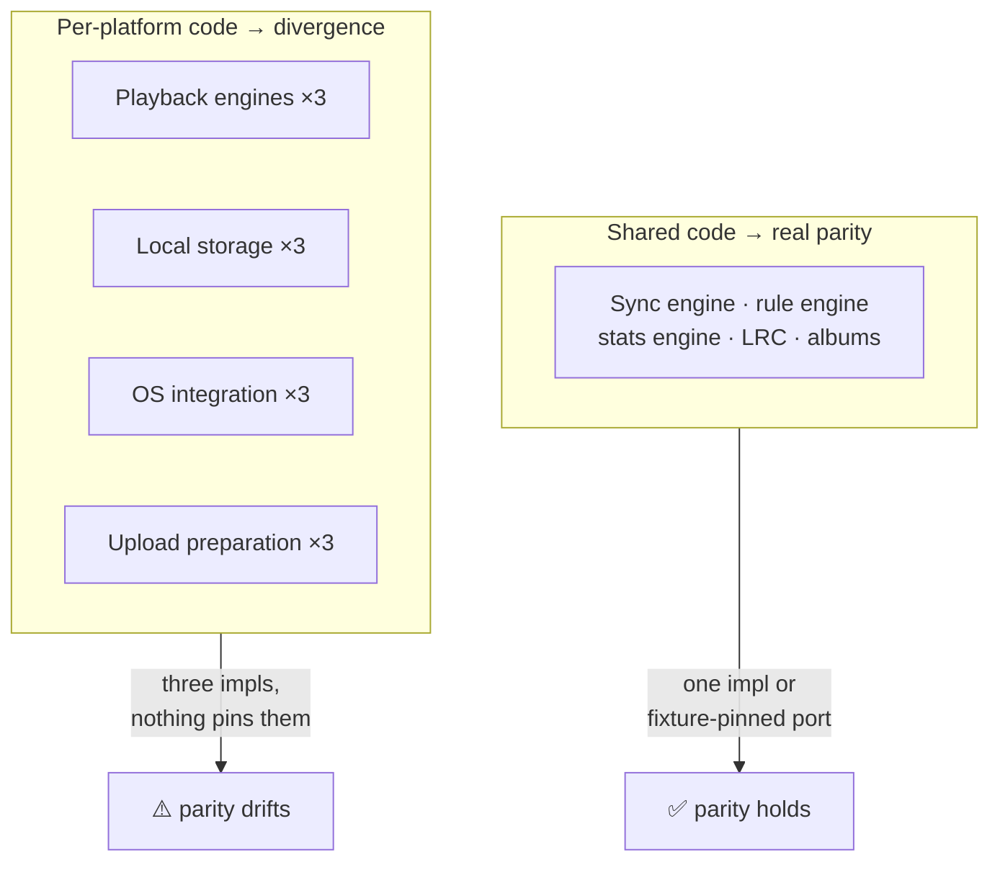
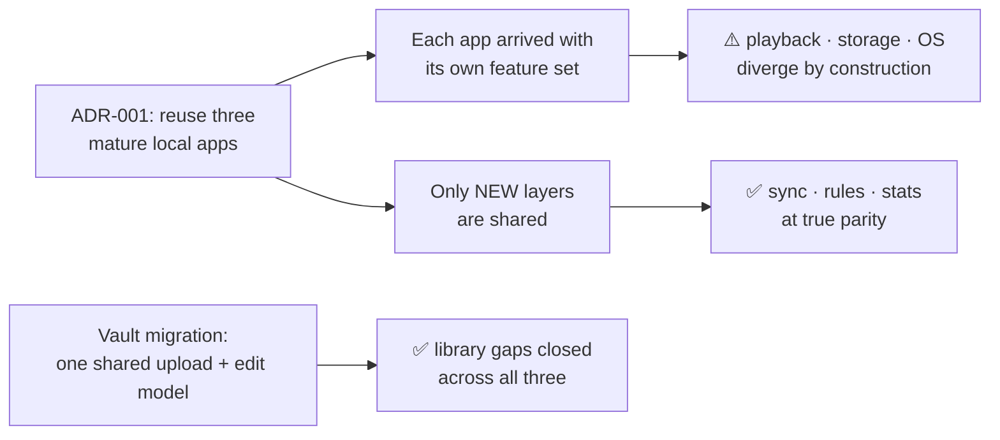

# Cross-Platform Feature Parity

> Audit date: 2026-07-17 · branch `main` @ `e3b5237`; library, vault, caching, downloads and
> auth sections updated 2026-10-13 for the vault, which replaced Google Drive and local folders;
> caching, downloads, statistics, settings and UI rows updated 2026-10-15.
> Every feature from [FEATURES.md](FEATURES.md), scored per platform. Legend:
> **✅ Full** · **⚠️ Partial / behaves differently** · **❌ Missing** · **🚧 Planned — not implemented**
>
> Every ⚠️ and ❌ cites the file(s) implementing it where it exists and describes **the gap a user
> would actually notice**. Features that are technically present everywhere but *behave differently*
> are flagged ⚠️ and collected in [§ Silent divergences](#silent-divergences) — those are the
> dangerous ones.

## Executive summary

Parity is strongest exactly where the code is shared and weakest where it isn't. The **sync engine,
rule engine and stats engine** are at true parity because they are one implementation (or a
fixture-pinned port). **Playback, storage and OS integration** diverge because they were always three
codebases — see [ADR-001](ARCHITECTURE_DECISIONS.md#adr-001-reuse-three-mature-apps-rather-than-rewrite).

Three findings dominate:

1. **The library is now the same on every client.** Since the vault migration, all three apps
   project the same synced `tracks` rows, upload by hand, edit details online and delete from the
   vault. The old "web has no local library" and "stale Drive copy" gaps are gone with Drive.
2. **Android's recap is dead code.** The engine is fully ported and golden-tested; no screen calls it.
3. **ReplayGain is still desktop-only** — applied only there, and an upload from Android carries no
   ReplayGain values because JAudioTagger can't read them.

---

## Library

| Feature | Desktop | Android | Web | Notes / Discrepancy |
|---|:---:|:---:|:---:|---|
| Upload to the vault | ✅ | ✅ | ✅ | Shared `uploadTrack` ([core/upload.ts](../packages/core/src/upload.ts)) on desktop/web; Android mirrors it in [UploadManager.kt](../apps/android/app/src/main/java/com/musicvault/data/vault/UploadManager.kt). Same review form, batch fields and shared cover everywhere. |
| Add files by drag-and-drop | ✅ | ⚠️ | ✅ | Desktop: [useFileDrop.ts](../apps/desktop/src/hooks/useFileDrop.ts) (files or folders dropped on the window). Web: files dropped on the window ([MusicVaultApp.tsx](../apps/web/src/components/MusicVaultApp.tsx)). Android has no drop target; it takes **Share → Music Vault** from other apps instead ([MainActivity.kt](../apps/android/app/src/main/java/com/musicvault/MainActivity.kt)). Platform-shaped, not a gap. |
| Whole-folder upload | ✅ | ❌ | ❌ | Desktop walks a picked folder in Rust ([vault/prepare.rs](../apps/desktop/src-tauri/src/vault/prepare.rs)). Android and web pick multiple files. **Impact**: uploading a large collection is easiest from desktop. |
| Tag reading for the upload form | ✅ | ⚠️ | ✅ | Desktop `lofty` ([scan/tags.rs](../apps/desktop/src-tauri/src/scan/tags.rs)); web `music-metadata` ([uploadPrepare.ts](../apps/web/src/lib/uploadPrepare.ts)); Android JAudioTagger ([TagParser.kt](../apps/android/app/src/main/java/com/musicvault/data/scanner/TagParser.kt)) — **cannot read ReplayGain tags**. **Impact**: a song uploaded from Android has no ReplayGain values (they are read-only afterwards); upload it from desktop or web to keep them. |
| Content hashing (BLAKE3) | ✅ | ✅ | ✅ | The track's identity everywhere: Rust [scan/hash.rs](../apps/desktop/src-tauri/src/scan/hash.rs), `hash-wasm` on the web, `Blake3` on Android. Re-uploading a known song attaches to its row. |
| Edit details and covers online | ✅ | ✅ | ✅ | `track.edit` op, field-level last-writer-wins, pinned in SQL, TypeScript and Kotlin by [track-edit.golden.json](../docs/fixtures/track-edit.golden.json). True parity. |
| Delete from vault | ✅ | ✅ | ✅ | Track menu and multi-select, behind a confirmation; every device drops its copy when the tombstone arrives. |
| Library projection | ✅ | ✅ | ✅ | Desktop [vaultMerge.ts](../apps/desktop/src/lib/vaultMerge.ts) · web [trackMap.ts](../apps/web/src/lib/trackMap.ts) · Android [VaultMerge.kt](../apps/android/app/src/main/java/com/musicvault/data/vault/VaultMerge.kt). Three small implementations of one rule (rows with audio, queued edits laid over); not fixture-pinned. |
| Browse (albums/artists/genre/year/language) | ✅ | ✅ | ✅ | Shared: [core/albums.ts](../packages/core/src/albums.ts), [core/smartPlaylists.ts:85-104](../packages/core/src/smartPlaylists.ts) + Kotlin ports. True parity. |
| Search & sort | ✅ | ✅ | ✅ | Per-client store logic (`search`, `sortKey`: title/artist/album). |
| Virtualized track lists | ✅ | ✅ | ✅ | Desktop/web share `useVirtualRows` 1:1 ([docs/architecture.md:152-155](../docs/architecture.md)); Android gets it free from Compose lazy lists ([TrackList.kt](../apps/android/app/src/main/java/com/musicvault/ui/components/TrackList.kt)). Different mechanism, equivalent result. |

---

## Playback

| Feature | Desktop | Android | Web | Notes / Discrepancy |
|---|:---:|:---:|:---:|---|
| Playback engine | ✅ | ✅ | ✅ | Three independent engines by design: Rust Symphonia→EQ→cpal ([audio/](../apps/desktop/src-tauri/src/audio)), Media3 dual-ExoPlayer ([VaultPlayer.kt](../apps/android/app/src/main/java/com/musicvault/playback/VaultPlayer.kt)), Web Audio ([audioEngine.ts](../apps/web/src/lib/audioEngine.ts)). |
| Format support | ✅ | ⚠️ | ⚠️ | Desktop is the widest: Symphonia (mp3/flac/wav/pcm/ogg/vorbis/isomp4/aac/alac) **plus `.ape`** (`ape-decoder`) and **`.wv`** (vendored libwavpack, [audio/wv.rs](../apps/desktop/src-tauri/src/audio/wv.rs)). Android is limited to ExoPlayer's codecs; web to the browser's. **Impact**: APE and WavPack files play on desktop only — on the other clients they appear in the library (they're in the vault) but fail to play. |
| Transport (play/pause/seek/volume) | ✅ | ✅ | ✅ | |
| Queue | ✅ | ⚠️ | ✅ | Desktop/web: [QueuePanel.tsx](../apps/desktop/src/components/QueuePanel.tsx). Android: `QueueSheet` ([PanelSheets.kt:111](../apps/android/app/src/main/java/com/musicvault/ui/player/PanelSheets.kt)) — functionally present, but Android **persists the queue in Room** (`queue_items`, [Entities.kt](../apps/android/app/src/main/java/com/musicvault/data/db/Entities.kt)) while desktop/web do not have that table. **Impact**: Android restores its queue after a cold start from its own DB; the others rely on the synced `queue_state` row. Subtly different behavior offline. |
| Shuffle & repeat | ✅ | ✅ | ✅ | Shared `RepeatMode` ([core/types.ts:55](../packages/core/src/types.ts)); synced. ⚠️ Only Android unit-tests this logic (14 cases, [QueueStateTest.kt](../apps/android/app/src/test/java/com/musicvault/playback/QueueStateTest.kt)). |
| Gapless | ✅ | ✅ | ⚠️ | Desktop `player_set_gapless`; Android dual-ExoPlayer. Web has the synced `gapless` setting ([core/types.ts:93](../packages/core/src/types.ts)) but no dual-source engine in [audioEngine.ts](../apps/web/src/lib/audioEngine.ts). **Impact**: the toggle exists on web but true gapless is a Web Audio scheduling problem the engine doesn't solve — expect a seam between tracks. |
| Crossfade | ✅ | ✅ | ⚠️ | Same shape as gapless: `crossfadeDuration` syncs everywhere; desktop (`player_set_crossfade`) and Android (dual-player) implement it. |
| 10-band equalizer | ✅ | ✅ | ✅ | Bands and presets defined once at [core/types.ts:104-111](../packages/core/src/types.ts). Desktop `biquad` ([audio/eq.rs](../apps/desktop/src-tauri/src/audio/eq.rs)); Android [EqController.kt](../apps/android/app/src/main/java/com/musicvault/playback/EqController.kt); web Web Audio filters. Real parity — the *values* are shared even though the DSP isn't. |
| **ReplayGain** | ✅ | ❌ | ❌ | **Explicitly stated in the shared type**: "ReplayGain volume normalization (**synced; only desktop applies it**)" ([core/types.ts:96-97](../packages/core/src/types.ts)). Desktop applies per-stream gain inside `StreamState::pull` so it survives gapless splices ([docs/architecture.md:121-124](../docs/architecture.md)); `player_set_rg` ([commands/player.rs:70](../apps/desktop/src-tauri/src/commands/player.rs)). Android and web **store and sync `replayGainMode` and the gain values but never apply them**. **Impact**: a user sets ReplayGain to "album" on desktop, sees the setting reflected on their phone, and hears **no volume normalization there** — the most misleading gap in the product. |
| Visualizer | ✅ | ✅ | ✅ | Desktop `rustfft` ([audio/analyzer.rs](../apps/desktop/src-tauri/src/audio/analyzer.rs)) toggled by `player_set_visualizer`; Android [VisualizerSheet.kt](../apps/android/app/src/main/java/com/musicvault/ui/player/VisualizerSheet.kt); web [Visualizer.tsx](../apps/web/src/components/Visualizer.tsx). |
| Lyrics (plain + LRC) | ✅ | ✅ | ✅ | Parser shared: [core/lrc.ts](../packages/core/src/lrc.ts) ↔ [Lrc.kt](../apps/android/app/src/main/java/com/musicvault/domain/Lrc.kt), both tested. |
| Sleep timer | ✅ | ✅ | ✅ | [SleepTimer.tsx](../apps/desktop/src/components/SleepTimer.tsx) (desktop/web) + `sleepStore`; [SleepTimerButton.kt](../apps/android/app/src/main/java/com/musicvault/ui/player/SleepTimerButton.kt). |
| Mini player | ✅ | ❌ | ❌ | Desktop only: a frameless always-on-top second webview; main window hides and stays the "brain" ([commands/window.rs](../apps/desktop/src-tauri/src/commands/window.rs), [miniBridge.ts](../apps/desktop/src/lib/miniBridge.ts)). **Impact**: none elsewhere — Android has a mini player *bar* ([MiniPlayerBar.kt](../apps/android/app/src/main/java/com/musicvault/ui/player/MiniPlayerBar.kt)), which is a different concept; a floating always-on-top window is meaningless on a phone and impossible in a browser tab. **Not a real gap.** |
| Preload next track | ✅ | ✅ | ❌ | Desktop `player_preload_next` ([commands/player.rs:61](../apps/desktop/src-tauri/src/commands/player.rs)); Android's dual-player prepares the next source. No web equivalent. |

---

## OS integration

Genuinely platform-shaped — differences here are appropriate, not defects.

| Feature | Desktop | Android | Web | Notes |
|---|:---:|:---:|:---:|---|
| Media keys / session | ✅ SMTC | ✅ MediaSession | ✅ Media Session API | [smtc.rs](../apps/desktop/src-tauri/src/smtc.rs) (`souvlaki`) · [PlaybackService.kt](../apps/android/app/src/main/java/com/musicvault/playback/PlaybackService.kt) · [useMediaSession.ts](../apps/web/src/hooks/useMediaSession.ts). Desktop degrades gracefully: "Media keys are non-essential; run without them" ([lib.rs:110-114](../apps/desktop/src-tauri/src/lib.rs)). |
| System tray | ✅ | ❌ | ❌ | [tray.rs](../apps/desktop/src-tauri/src/tray.rs). Platform-inapplicable elsewhere. |
| Windows jump list | ✅ | ❌ | ❌ | [jumplist.rs](../apps/desktop/src-tauri/src/jumplist.rs) (`ICustomDestinationList`); tasks relaunch with `--media-control=<action>`, routed by the single-instance plugin ([lib.rs:18-30](../apps/desktop/src-tauri/src/lib.rs)). |
| Background playback | ✅ | ✅ | ⚠️ | Android uses a foreground `MediaSessionService`. Web playback stops with the tab; that's the platform. |
| Android Auto | ❌ | ✅ | ❌ | [automotive_app_desc.xml](../apps/android/app/src/main/res/xml/automotive_app_desc.xml). |
| Desktop notifications | ✅ | ⚠️ | ✅ | Desktop `tauri-plugin-notification` + [NotificationToggle.tsx](../apps/desktop/src/components/NotificationToggle.tsx); web [useNotifications.ts](../apps/web/src/hooks/useNotifications.ts) + toggle. **Android has no `notificationsEnabled` setting** — grep finds no `NOTIF` key in [SettingsRepository.kt](../apps/android/app/src/main/java/com/musicvault/data/prefs/SettingsRepository.kt). **Impact**: the shared `notificationsEnabled` setting ([core/types.ts:95](../packages/core/src/types.ts)) syncs to Android and is ignored — Android instead shows the persistent MediaSession notification, which the toggle cannot control. |
| Keyboard shortcuts | ✅ | ❌ | ✅ | `useKeyboardShortcuts.ts` on desktop and web only. Appropriate. |

---

## The vault

Full detail: [VAULT.md](VAULT.md).

| Feature | Desktop | Android | Web | Notes / Discrepancy |
|---|:---:|:---:|:---:|---|
| Signed URLs from the `vault` function | ✅ | ✅ | ✅ | Core `createSupabaseVaultApi` + `SignedUrlCache` ([core/vault.ts](../packages/core/src/vault.ts)) on desktop/web; [VaultApi.kt](../apps/android/app/src/main/java/com/musicvault/data/vault/VaultApi.kt) on Android. No client holds R2 keys. |
| Download-then-play | ✅ | ✅ | ✅ | Desktop Rust [vault/transfer.rs](../apps/desktop/src-tauri/src/vault/transfer.rs) · Android [VaultDataSource.kt](../apps/android/app/src/main/java/com/musicvault/playback/VaultDataSource.kt) through Media3's cache · web [audioCache.ts](../apps/web/src/lib/audioCache.ts). |
| BLAKE3 download verification | ✅ | ⚠️ | ✅ | Desktop and web hash while writing and reject a mismatch. Android verifies pinned downloads ([DownloadRepository.kt](../apps/android/app/src/main/java/com/musicvault/data/vault/DownloadRepository.kt)) but not the streaming cache. **Impact**: a corrupted streamed copy on Android plays as a broken file until it's evicted. |
| Per-file download dedupe | ✅ | ✅ | ✅ | Desktop waits on the in-flight download ([vault/mod.rs](../apps/desktop/src-tauri/src/vault/mod.rs)); web's `inFlight` map ([audioCache.ts](../apps/web/src/lib/audioCache.ts)); Android's WorkManager unique work. |
| Covers by key (full + thumbnail) | ✅ | ✅ | ✅ | Desktop `fetchVaultArt` ([lib/vault.ts](../apps/desktop/src/lib/vault.ts)) · [VaultArtwork.kt](../apps/android/app/src/main/java/com/musicvault/data/vault/VaultArtwork.kt) · web [artwork.ts](../apps/web/src/lib/artwork.ts). Covers show before the audio is downloaded on every client. |
| "Download all" | ✅ | ✅ | ✅ | Desktop and web Downloads view (desktop 4 at a time, web 1, [downloadStore.ts](../apps/desktop/src/store/downloadStore.ts)); Android via auto-download. Collection Download buttons show done/left and cancel while running, and remove the downloads once complete (all clients, 2026-10-15). |
| Download speed / aggregate UI | ✅ | ⚠️ | ✅ | `DownloadsView.tsx` on desktop and web show live speed and a total; Android surfaces `WorkInfo` progress per song. |

---

## Caching

| Feature | Desktop | Android | Web | Notes / Discrepancy |
|---|:---:|:---:|:---:|---|
| Two-tier model (auto + pinned) | ✅ | ⚠️ | ✅ | Same *model*, three mechanisms. Desktop: `cache_entries` rows keyed `vault:<hash>` + own LRU + `pinned` flag ([vault/cache.rs](../apps/desktop/src-tauri/src/vault/cache.rs)). Web: OPFS bytes + IndexedDB `tier: "cache" \| "pin"` ([db.ts](../apps/web/src/lib/db.ts)). **Android: tier 1 is Media3 `SimpleCache` with its own LRU and no Room bookkeeping; only tier 2 gets a `downloads` table** ([Entities.kt](../apps/android/app/src/main/java/com/musicvault/data/db/Entities.kt)). |
| Configurable size cap | ✅ | ✅ | ✅ | Device-local on every client, Off or up to 10 GiB, with different defaults: desktop `cache_max_bytes` **10 GiB** (`vault_cache_set_max` evicts immediately, [commands/vault.rs](../apps/desktop/src-tauri/src/commands/vault.rs)); Android **2 GiB** ([AudioCache.kt](../apps/android/app/src/main/java/com/musicvault/data/vault/AudioCache.kt), applied immediately since 2026-10-15; Off streams without the cache); web **4 GiB** ([audioCache.ts](../apps/web/src/lib/audioCache.ts)). Desktop and web never evict the two most recent songs (playing + next), so Off keeps just those. Not synced — by design, disks differ. |
| Clear cache | ✅ | ✅ | ✅ | Downloads page button; pinned downloads stay. |
| Auto-download (keep the whole vault) | ✅ | ✅ | ✅ | Device-local switch on Downloads ([downloadStore.ts](../apps/desktop/src/store/downloadStore.ts), [AutoDownloader.kt](../apps/android/app/src/main/java/com/musicvault/data/vault/AutoDownloader.kt), web [downloadStore.ts](../apps/web/src/store/downloadStore.ts)); playback skips the auto-cache while it is on. Web only downloads while the site is open. |
| Pinned never evicted | ✅ | ✅ | ✅ | Desktop's `idx_cache_lru (pinned, last_access)` sorts pinned rows away from eviction; Android separates the table entirely; web uses the `tier` index. |
| Promote cache → pinned without re-download | ✅ | ⚠️ | ⚠️ | Desktop `promote_to_pinned` ([vault/cache.rs](../apps/desktop/src-tauri/src/vault/cache.rs)). **Impact**: on Android/web, pinning an already-cached track may re-download it — the tiers are separate stores there, not a flag. |
| Self-healing index | ✅ | — | — | Desktop `resolve_cached` cleans up stale index rows whose file vanished ([vault/cache.rs](../apps/desktop/src-tauri/src/vault/cache.rs)). |
| Drop copies of deleted tracks | ✅ | ✅ | ✅ | Desktop `vault_forget_deleted` ([vaultCleanup.ts](../apps/desktop/src/lib/vaultCleanup.ts)), Android `forgetDeleted`, web via `deletedVaultHashes` ([core/vault.ts](../packages/core/src/vault.ts)). |
| Artwork thumbnails | ✅ | ⚠️ | ✅ | The vault stores a 256 px thumbnail beside each cover. Desktop downloads both ([lib/vault.ts](../apps/desktop/src/lib/vault.ts)); web downscales lazily into IndexedDB `thumb:` keys ([artwork.ts](../apps/web/src/lib/artwork.ts)); Android keeps the full cover and relies on Coil's caching. Equivalent outcome. |

---

## Favorites

| Feature | Desktop | Android | Web | Notes |
|---|:---:|:---:|:---:|---|
| Favorites | ✅ | ✅ | ✅ | Soft state since migration 0003 ([0003_sync.sql:12-14](../supabase/migrations/0003_sync.sql)). |
| Sync | ✅ | ✅ | ✅ | `favorite.set` ops, LWW on `edited_at`. True parity — shared engine. Star ratings were retired 2026-10-13. |

---

## Playlists

| Feature | Desktop | Android | Web | Notes / Discrepancy |
|---|:---:|:---:|:---:|---|
| Manual playlists (CRUD) | ✅ | ✅ | ✅ | [commands/playlists.rs](../apps/desktop/src-tauri/src/commands/playlists.rs) · [LibraryRepository.kt](../apps/android/app/src/main/java/com/musicvault/data/repo/LibraryRepository.kt) · web store. |
| Drag-and-drop reordering | ✅ | ✅ | ✅ | Desktop/web `@dnd-kit`; Android hand-rolled (`draggable` param, [TrackList.kt:80-116](../apps/android/app/src/main/java/com/musicvault/ui/components/TrackList.kt)). |
| Mergeable concurrent reorder | ✅ | ✅ | ✅ | Fractional indexes ([core/sync/fractional.ts](../packages/core/src/sync/fractional.ts) + [Fractional.kt](../apps/android/app/src/main/java/com/musicvault/data/sync/Fractional.kt)), both tested with 6 cases each. |
| Not-yet-downloaded tracks in playlists | ✅ | ✅ | ✅ | Entries reference the synced track id; no client needs the audio on disk to list them. |
| **Playlist folders** | 🚧 | 🚧 | 🚧 | ⚠️ **Schema-ready on every platform, implemented on none.** Supabase has `is_folder` + `parent_id` ([0001_init.sql:136-147](../supabase/migrations/0001_init.sql)) and `PlaylistSnapshot` carries `isFolder`/`parentId` ([core/sync/types.ts:53-62](../packages/core/src/sync/types.ts)) — but the desktop `playlists` table has **no such columns at all** ([db/mod.rs:64-68, 100-101](../apps/desktop/src-tauri/src/db/mod.rs)) and no client has a folder UI. Half-built since Phase 1. |

---

## Smart Playlists

| Feature | Desktop | Android | Web | Notes |
|---|:---:|:---:|:---:|---|
| Built-in smart playlists (9) | ✅ | ✅ | ✅ | [core/smartPlaylists.ts:23-33](../packages/core/src/smartPlaylists.ts) ↔ [SmartPlaylists.kt](../apps/android/app/src/main/java/com/musicvault/domain/SmartPlaylists.kt). |
| Rule-based smart playlists (13 fields, 21 ops) | ✅ | ✅ | ✅ | [core/smartRules.ts](../packages/core/src/smartRules.ts) ↔ [SmartRules.kt](../apps/android/app/src/main/java/com/musicvault/domain/SmartRules.kt), **pinned by [smart-rules.golden.json](../docs/fixtures/smart-rules.golden.json)**. |
| Rule builder UI | ✅ | ✅ | ✅ | `SmartRulesEditor` ×3, including a 351-line Compose version. |

**The strongest parity in the project** — and not by accident. Two implementations agree because a
shared fixture makes disagreement a test failure ([TESTING.md §1](TESTING.md#1-the-strategy-golden-fixtures-pin-two-implementations)).

---

## Statistics

| Feature | Desktop | Android | Web | Notes / Discrepancy |
|---|:---:|:---:|:---:|---|
| Local play-event log | ✅ | ✅ | ✅ | SQLite `play_events` (v5) · Room `play_events` (v6) · IndexedDB `mv-stats`. All three survive sign-out by design. |
| Event sync (`playEvent.add`) | ✅ | ✅ | ✅ | Append-only, deduped on shared event id. |
| Summary / top lists / charts / heatmap / clock / streaks | ✅ | ✅ | ✅ | [core/stats.ts](../packages/core/src/stats.ts) ↔ [Stats.kt](../apps/android/app/src/main/java/com/musicvault/domain/Stats.kt), pinned by [stats.golden.json](../docs/fixtures/stats.golden.json). |
| 6-month heatmap + full Listening History | ✅ | ✅ | ✅ | `Heatmap.tsx` ×2 · [HeatmapScreen.kt](../apps/android/app/src/main/java/com/musicvault/ui/screens/HeatmapScreen.kt). |
| Chart hover tooltips | ✅ | — | ✅ | One shared tooltip ([ChartTooltip.tsx](../apps/desktop/src/components/ChartTooltip.tsx)); touch has no hover, and Android's heatmap squares are view-only. |
| **Yearly recap (Wrapped-style)** | ✅ | ❌ | ✅ | Desktop [RecapView.tsx](../apps/desktop/src/components/RecapView.tsx) · web [RecapView.tsx](../apps/web/src/components/RecapView.tsx). **Android has the engine fully ported** — `Stats.Recap`, `computeRecap`, `recapYears` at [Stats.kt:380-458](../apps/android/app/src/main/java/com/musicvault/domain/Stats.kt), covered by [StatsGoldenTest.kt](../apps/android/app/src/test/java/com/musicvault/domain/StatsGoldenTest.kt) — **but nothing calls it**: verified by grep across [StatsScreen.kt](../apps/android/app/src/main/java/com/musicvault/ui/screens/StatsScreen.kt), [StatsViewModel.kt](../apps/android/app/src/main/java/com/musicvault/ui/StatsViewModel.kt) and [StatsRepository.kt](../apps/android/app/src/main/java/com/musicvault/data/repo/StatsRepository.kt) — zero references. **Impact**: Android users cannot see their yearly recap even though their device computes everything needed for it. Also the cheapest fix on this page: the hard part is done and tested. |
| Aggregated history table | ❌ | ⚠️ | ❌ | ⚠️ **Android-only `play_history`** (`playCount`, `listenSeconds`, `lastPlayedAt`) alongside the event log ([Entities.kt](../apps/android/app/src/main/java/com/musicvault/data/db/Entities.kt)), driving `HistoryRepository`. It is **not synced** and contradicts the "no play-count column anywhere" rule ([0001_init.sql:208-212](../supabase/migrations/0001_init.sql)). **Impact**: Android's "Most Played"/"Recently Played" can be computed from a *different source* than desktop/web's event-derived lists, so the same account can rank tracks differently on Android. |

---

## Sync

| Feature | Desktop | Android | Web | Notes |
|---|:---:|:---:|:---:|---|
| Sync engine | ✅ | ✅ | ✅ | [engine.ts](../packages/core/src/sync/engine.ts) (872) shared by desktop+web; [SyncEngine.kt](../apps/android/app/src/main/java/com/musicvault/data/sync/SyncEngine.kt) (785) is a hand port. |
| Persisted outbox | ✅ | ✅ | ✅ | SQLite / Room / IndexedDB implementations of one `SyncStorage` port. |
| LWW, coalescing, fractional merge, idempotent replay | ✅ | ✅ | ✅ | |
| All 10 op kinds | ✅ | ✅ | ✅ | |
| Realtime hints | ✅ | ✅ | ✅ | |
| Queue handoff | ✅ | ✅ | ✅ | Fixed post-1.0 across all three (`5423e5b`, `f381eb5`, `a1247c0`). |
| Breadcrumb diagnostics | ✅ | ⚠️ | ✅ | The Kotlin port "mirrors the emit points loosely (same events, not byte-identical detail)" — stated at [core/sync/types.ts:214-217](../packages/core/src/sync/types.ts). Observability only; no semantic impact. |
| Test coverage of conflicts | ✅ 22 | ⚠️ 18 | ✅ 22 | Desktop/web share the TS suite. ⚠️ The two engines are **not fixture-linked** — unlike rules/stats, nothing mechanically prevents drift in the project's most complex shared logic ([TESTING.md](TESTING.md#the-sync-engine-suite-765-lines-is-the-crown-jewel)). |

---

## Settings

| Feature | Desktop | Android | Web | Notes / Discrepancy |
|---|:---:|:---:|:---:|---|
| Shared `Settings` shape | ✅ | ✅ | ✅ | [core/types.ts:84-102](../packages/core/src/types.ts). |
| Storage | ✅ | ✅ | ✅ | Whole-object JSON in a key/value row (desktop) · DataStore per key (Android) · IndexedDB (web). |
| Per-device scoping | ✅ | ✅ | ✅ | Supabase `(user_id, scope, key)` where scope = `'global'` or a device id ([0001_init.sql:234-245](../supabase/migrations/0001_init.sql)). |
| Theme (dark/light) | ✅ | ✅ | ✅ | Synced. |
| Accent | ✅ | ✅ | ✅ | One accent, Vibrant Violet `#8B5CF6`, on every client since the 2026-10-13 redesign. The synced `accent` setting stays in the shape for older builds but is no longer applied (desktop [useTheme.ts](../apps/desktop/src/hooks/useTheme.ts)). |
| AMOLED | ✅ | ✅ | ✅ | Device-local, never synced ([core/types.ts:98-99](../packages/core/src/types.ts)); a switch beside the theme control in each account menu. |
| Follow system theme | ✅ | ✅ | ✅ | Device-local ([core/types.ts:100-101](../packages/core/src/types.ts)). |
| **Material You dynamic color** | ❌ | ✅ | ❌ | Android-only (`setDynamicColor`, [SettingsRepository.kt:100](../apps/android/app/src/main/java/com/musicvault/data/prefs/SettingsRepository.kt); [Theme.kt](../apps/android/app/src/main/java/com/musicvault/ui/theme/Theme.kt)), commit `d459f1e`. Platform-appropriate — **not a gap**. |
| `notificationsEnabled` | ✅ | ❌ | ✅ | See [OS integration](#os-integration): the setting syncs to Android and does nothing. |

---

## Downloads

| Feature | Desktop | Android | Web | Notes / Discrepancy |
|---|:---:|:---:|:---:|---|
| Downloads view | ✅ | ✅ | ✅ | `DownloadsView.tsx` ×2 · [DownloadsScreen.kt](../apps/android/app/src/main/java/com/musicvault/ui/screens/DownloadsScreen.kt). |
| Bulk download (song/album/artist/playlist) | ✅ | ✅ | ✅ | `DownloadAllButton.tsx` (desktop/web) · `enqueueAll` ([DownloadRepository.kt](../apps/android/app/src/main/java/com/musicvault/data/vault/DownloadRepository.kt)). |
| **Survives app death** | ❌ | ✅ | ❌ | ⚠️ **Android is ahead here.** WorkManager ([DownloadWorker.kt](../apps/android/app/src/main/java/com/musicvault/data/vault/DownloadWorker.kt)) resumes queued downloads after the process dies; desktop and web downloads are in-process and are lost on quit/tab-close. **Impact**: closing the desktop app mid-album-download abandons it. |
| Cancel a download | ✅ | ✅ | ✅ | Desktop `vault_download_cancel` stops the transfer at the next chunk; web aborts the fetch; Android `cancel(trackId)` ([DownloadRepository.kt](../apps/android/app/src/main/java/com/musicvault/data/vault/DownloadRepository.kt)). |
| Collection download progress, cancel, remove | ✅ | ✅ | ✅ | The Download button shows done/left, cancels while running and removes the downloads when complete ([FEATURES.md](FEATURES.md#downloads)). |
| Remove a download | ✅ | ✅ | ✅ | Desktop `vault_download_remove` removes from disk **and** index. |

---

## Authentication

| Feature | Desktop | Android | Web | Notes / Discrepancy |
|---|:---:|:---:|:---:|---|
| Email/password sign-in & sign-up | ✅ | ✅ | ✅ | Shared [core/supabase/auth.ts](../packages/core/src/supabase/auth.ts) (desktop/web); [AuthRepository.kt](../apps/android/app/src/main/java/com/musicvault/data/cloud/AuthRepository.kt). No OAuth/social providers or magic links anywhere. |
| Device registration | ✅ | ✅ | ✅ | [core/supabase/devices.ts](../packages/core/src/supabase/devices.ts); platform CHECK constrains to `('desktop','android','web')`. |
| Account required | ✅ | ✅ | ✅ | There is no local mode: the library lives in the vault, so every client asks for sign-in first. Downloaded songs play offline once signed in. |
| Server-side rendered auth | ❌ | ❌ | ✅ | Web only: [proxy.ts](../apps/web/src/proxy.ts) refreshes cookies per request and gates routes. Platform-appropriate. |
| RLS isolation | ✅ | ✅ | ✅ | Enforced in the database for all clients equally. |
| Sign-out wipes sync state but keeps history | ✅ | ✅ | ✅ | Consistent by explicit design across all three ([ADR-008](ARCHITECTURE_DECISIONS.md#adr-008-append-only-play-events-no-play-count-column)). |

---

## UI

| Feature | Desktop | Android | Web | Notes |
|---|:---:|:---:|:---:|---|
| Component set | ✅ | ✅ | ✅ | Desktop 47 / web 47 components (2026-10-15) with largely matching names; Android is an independent Compose implementation. |
| Account menu under the avatar | ✅ | ✅ | ✅ | Same sections everywhere; Android's is a dropdown since 2026-10-15 ([AccountMenu.kt](../apps/android/app/src/main/java/com/musicvault/ui/AccountMenu.kt)). |
| Playlist covers (2×2 mosaic) | ✅ | ✅ | ✅ | `Mosaic.tsx` ×2 · [Mosaic.kt](../apps/android/app/src/main/java/com/musicvault/ui/components/Mosaic.kt); smart playlists use the songs their rules match. |
| Address bar follows the page | — | — | ✅ | Web only by nature ([lib/urlSync.ts](../apps/web/src/lib/urlSync.ts)). |
| Installable app (PWA), opens offline | — | — | ✅ | Since 2026-10-15 ([app/manifest.ts](../apps/web/src/app/manifest.ts), [public/sw.js](../apps/web/public/sw.js)); desktop and Android are installed apps already. |
| Volume control in the player | ✅ | ✅ | ✅ | Android's is a vertical slider on the full player since 2026-10-15 ([VolumeButton.kt](../apps/android/app/src/main/java/com/musicvault/ui/player/VolumeButton.kt)). |
| Sidebar / navigation | ✅ | ✅ | ✅ | `Sidebar.tsx` ×2 · [AppRoot.kt](../apps/android/app/src/main/java/com/musicvault/ui/AppRoot.kt) (bottom navigation since the 2026-10-13 redesign). Collapsible sections + header account menu added post-1.0 (`8ff276c`, `d441968`) to desktop and web only. |
| State management | ✅ | ✅ | ✅ | 11 identical Zustand stores on desktop/web; Hilt ViewModels on Android. |
| Error toasts | ✅ | ⚠️ | ✅ | `ErrorToast` + `errorBus.ts` (desktop/web); Android surfaces errors per-screen. |
| Lazy-loaded heavy views | ❌ | — | ✅ | Web only ([docs/architecture.md:156-157](../docs/architecture.md)) — a bundle-size concern that doesn't apply to a native app. **Not a gap.** |
| **Public `/help` user docs** | ❌ | ❌ | ✅ | [apps/web/src/app/help/page.tsx](../apps/web/src/app/help/page.tsx), reachable signed-out. **Impact**: desktop and Android have no in-app user documentation — users must find the website. |

---

## Silent divergences

Features present on all three platforms that **behave differently**. These are the ones that produce
support tickets, because nothing looks broken:

| # | Feature | The divergence |
|---|---|---|
| 1 | **ReplayGain** | Setting syncs and displays everywhere; **only desktop applies it**. The user sees the control honored on their phone and hears nothing change. ([core/types.ts:96-97](../packages/core/src/types.ts)) |
| 3 | **`notificationsEnabled`** | Syncs to Android, which has no such setting and shows its MediaSession notification regardless. |
| 4 | **ReplayGain on upload** | Desktop and web read ReplayGain tags into the row; Android can't, so the same file uploaded from the phone has none — and the values are read-only afterwards. |
| 5 | **"Most Played" / "Recently Played"** | Desktop and web derive them from play events; Android can derive them from its `play_history` aggregates. Same list, different source of truth. ([Entities.kt](../apps/android/app/src/main/java/com/musicvault/data/db/Entities.kt)) |
| 6 | **Queue persistence** | Android restores from Room `queue_items`; desktop/web rely on the synced `queue_state` row. Offline restart behavior differs. |
| 7 | **Streamed-copy verification** | Desktop and web check every download against the track's BLAKE3; Android checks pinned downloads only, not what Media3 caches while streaming. |
| 8 | **Track duration units** | Room stores `durationMs`; core and desktop use **seconds**. Correct today via `Mappers.kt`, but a live trap for anyone writing a query or a new rule field. ([DATABASE.md §3.3](DATABASE.md#33-structural-differences-from-desktop-sqlite)) |
| 9 | **Gapless/crossfade** | The settings sync to web, which has no dual-source engine to honor them. |
| 10 | **Cache cap defaults** | Each device keeps its own cap — 10 GiB desktop, 2 GiB Android, 4 GiB web. Intentional, but the same "cache" means different amounts of offline music. |

---

## Where the gaps come from

The parity story is a direct consequence of
[ADR-001](ARCHITECTURE_DECISIONS.md#adr-001-reuse-three-mature-apps-rather-than-rewrite): reusing
three excellent local players bought an enormous head start and locked in three playback stacks,
three storage engines and three feature histories. The phase plan closed that gap deliberately
(Phase 6 was "Android cloud parity"). Post-1.0 Drive work then landed on desktop first; the vault
migration (2026-10) replaced all of it with one model built on all three clients at once — see
[docs/drive-to-r2-migration.md](../docs/drive-to-r2-migration.md).

**Nothing in CI checks parity**, and nothing could: there is no shared acceptance suite spanning the
three clients. Parity is currently maintained by intent alone.

## Recommended order of closure

Ranked by user-visible value per unit of effort — see [ROADMAP.md](ROADMAP.md#1-cross-platform-parity-backfill):

1. **Android recap screen** — engine done, tested, unreachable. Pure UI. 🥇
2. **ReplayGain application (Android, web)** — closes the most misleading synced-setting lie.
3. **ReplayGain reading on Android uploads** — so a phone upload carries the same values.
4. **`notificationsEnabled` (Android)** — small, removes a silent no-op.
5. **Retire `play_history`** — removes divergence #5 at the root.
