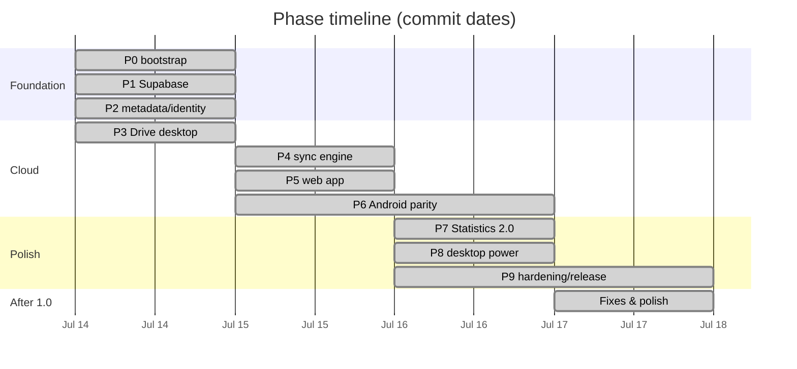

# Phase Progress

> Audit date: 2026-07-17 · branch `main` @ `e3b5237`; the vault migration (2026-10-11 to 13) is
> added at the end. The phase rows below are a historical record and still describe Drive and
> local folders as they were built.
> **Derived from the repository**: `git log` (45 commits, 2026-07-14 → 2026-07-17, single branch
> `main`, no merges), the phase definitions in [PLAN.md](../PLAN.md), and verification against the
> code cited throughout. Not from prior conversations.

## Summary

The history is unusually legible: **every phase has at least one commit whose subject names it**,
in strict order, over four days. Phases 0–5 are single commits; Phases 6–9 are lettered series
(`6a`…`6e`, `7a`…`7e`, `8a`…`8f`, `9a`…`9e`). All ten phases are complete. The 13 commits after the
final phase commit are post-1.0 fixes and polish.

The vault migration (2026-10-11 → 13) is charted separately in
[§ Vault migration](#vault-migration-2026-10-11-to-13).

## Phase table

| Phase | Status | Commit(s) | Summary | Remaining work |
|---|---|---|---|---|
| **0 — Workspace bootstrap** | ✅ Complete | `80edb55` (07-14) | Monorepo: desktop + android apps imported, shared `@musicvault/core` extracted and consumed by desktop, builds verified | None |
| **1 — Supabase foundation** | ✅ Complete | `6ca4171` (07-14) | Schema + RLS migration ([0001_init.sql](../supabase/migrations/0001_init.sql)), core supabase module, sign-in/up + device registration on desktop and Android | Requires a hand-provisioned Supabase project; **no migration runner exists** ([BUILD_AND_RUN.md](BUILD_AND_RUN.md#6-supabase)) |
| **2 — Metadata & track identity** | ✅ Complete | `2fceaa8` (07-14) | Extended tags, ratings, BLAKE3 hashing, shared smart-rule engine (TS + Kotlin, golden fixtures). SQLite v2, Room `MIGRATION_1_2` | Android cannot read ReplayGain tags (JAudioTagger limitation) — values arrive via desktop/sync ([Entities.kt:30-32](../apps/android/app/src/main/java/com/musicvault/data/db/Entities.kt)) |
| **3 — Google Drive on desktop** | ✅ Complete | `b99db37`, `edae1ac`, `8ac57aa` (07-14) | 3a PKCE OAuth (loopback, Credential Manager) · 3b scanner + library merge with cloud badge · 3c two-tier cache, hybrid playback, downloads UI, metadata push. SQLite v3, migration 0002 | None for desktop |
| **4 — Sync engine** | ✅ Complete | `5ae7b45` (07-15) | Persisted outbox, LWW merge, fractional indexes, Realtime, queue handoff. SQLite v4, migration 0003, [docs/sync-protocol.md](../docs/sync-protocol.md) | None |
| **5 — Web app** | ✅ Complete | `5d27bfb`, `7e0788c` (07-15) | Next.js 16 rewrite: SSR auth, sync engine on IndexedDB, Drive via OPFS cache, Web Audio playback; + web setup docs | ⚠️ No local file import — the web library was Drive/cloud-only. ✅ Closed by the vault migration (web uploads) |
| **6 — Android cloud parity** | ✅ Complete | `8c0ddd9`, `b74c358` (07-15); `d1f6e58`, `f2455ee`, `9cf0c0d`, `d459f1e` (07-15/16) | 6a Kotlin sync-engine port (fractional index, op envelope, LWW flush/pull, full test suite) + wiring · 6b Drive OAuth/scanner/merge · 6c two-tier cache, WorkManager downloads, hybrid playback · 6d smart-rule builder UI · 6e Material You + AMOLED. Room v3→v6 | ⚠️ No Drive change detection or cloud-only artwork. ✅ Moot since the vault (immutable objects, covers by key) |
| **7 — Statistics 2.0** | ✅ Complete | `9b6e498`, `cc6d8ee`, `bcf3d48`, `4a66c95`, `02d7e53` (07-16) | 7a core stats engine with golden fixtures · 7b desktop · 7c web (IndexedDB log, charts, heatmap, recap) · 7d Android (event log, `playEvent.add` wiring, Kotlin stats engine) · 7e docs. SQLite v5, Room `MIGRATION_5_6` | ⚠️ **Recap UI missing on Android** — the engine is ported ([Stats.kt:380-458](../apps/android/app/src/main/java/com/musicvault/domain/Stats.kt)) but unreachable; the legacy `play_history` table remains alongside the event log |
| **8 — Desktop polish & power** | ✅ Complete | `5cbe27f`, `a8404f0`, `aac1468`, `f8460da`, `a399c79`, `2ec6a83` (07-16) | 8a AMOLED + accent picker + system theme · 8b mini player + multiwindow · 8c tray + jump lists · 8d ReplayGain stage + APE/WavPack decoders · 8e folder watching + duplicate detection · 8f docs. SQLite v6 | By design desktop-only; Android/web have no mini player, tray, duplicates or ReplayGain application |
| **9 — Hardening & release** | ✅ Complete | `c889289`, `e2ea257`, `72363ae`, `8d811d5`, `36e11d8` (07-16/17) | 9a Rust cache-LRU tests + Playwright e2e · 9b sync breadcrumbs + logging audit · 9c virtualized lists, thumbnails, lazy views, startup profiling · 9d GitHub Actions CI + NSIS/APK release · 9e setup guide, `/help`, sync-protocol diagnostics, README | 🚧 Android release APK is **debug-signed** — "Play-store signing is out of scope for v1" ([release.yml](../.github/workflows/release.yml)) |

## Post-1.0 work (2026-07-17, 13 commits)

Everything after `36e11d8` is unlabelled by phase — the plan was finished. Grouped by theme:

| Theme | Commits | What |
|---|---|---|
| **Drive & downloads (desktop)** | `dc3ce6e`, `b3b9c50`, `3e94b37`, `e8c0ef4`, `e3b5237` | "Sync to this device" mirroring; bounded-concurrency downloads; live speed + aggregate total; re-fetch files whose content changed (SQLite **v7**); cover art for cloud-only tracks (SQLite **v8**) |
| **Queue correctness** | `5423e5b`, `a1247c0`, `f381eb5` | Clearing the queue also clears the saved resume point (desktop, then web) and propagates to other devices — one bug fixed in three places, which is a fair illustration of the three-client tax |
| **UI shell** | `8ff276c`, `d441968`, `cfe0b6b` | Collapsible sidebar sections + account menu in the top bar; account control folded into each view's header (25 files); desktop icon reused as the web favicon |
| **Stability** | `62a4e1b` | Jump-list crash on startup (black screen, auto-close) — a Phase 8c regression |
| **Docs** | `73c0e9e` | Android Drive setup: the Custom URI Scheme step |
| **Metadata** | `3435a8d` | Keep the folder-derived language on synced cloud tracks |

Two observations worth carrying forward:
- Post-1.0 commits were **overwhelmingly desktop-first** (5 of 6 Drive/download improvements were
  desktop-only), which is how the parity gaps widened after the phase plan closed — until the
  vault migration replaced that whole layer on all three clients at once.
- The queue-clear bug needed three commits across three clients. The sync engine is shared; the
  *player* is not.

## Milestones from PLAN.md

[PLAN.md:267-275](../PLAN.md) defined six milestones. All are met:

| Milestone | Definition | Status |
|---|---|---|
| M1 (P0–P1) | Monorepo runs, sign-in works on desktop | ✅ |
| M2 (P2–P3) | Desktop plays your Drive library through the cache — "the core promise works" | ✅ (Drive since replaced by the vault) |
| M3 (P4) | Two desktop installs stay in sync | ✅ |
| M4 (P5) | Website live on Vercel with browse/playlists/stats | ✅ (code complete; deployment is external to the repo — no `vercel.json`) |
| M5 (P6) | Android full parity — "the ecosystem is complete" | ⚠️ Achieved as scoped in Phase 6; parity has since drifted — [FEATURE_PARITY.md](FEATURE_PARITY.md) |
| M6 (P7–P9) | Stats, polish, release quality | ✅ |

## Explicitly out of scope for v1

[PLAN.md:260-263](../PLAN.md) names three items, all confirmed absent from the code:

- 🚧 **WASAPI Exclusive / ASIO output backends** — PLAN.md says they "slot into the existing output
  trait". ⚠️ **No such trait exists**: [audio/output.rs](../apps/desktop/src-tauri/src/audio/output.rs)
  defines a concrete `Output` struct over `cpal`. The work is larger than the plan implies —
  [ARCHITECTURE_DECISIONS.md](ARCHITECTURE_DECISIONS.md#adr-011-replaceable-components-aspirational-in-two-places).
- 🚧 **Multiple users / library sharing** — every RLS policy is `user_id = auth.uid()`; the schema
  has no sharing concept.
- ~~Additional storage providers behind the Drive client interface~~ — superseded: Drive itself was
  replaced by the R2 vault, which any S3-compatible store could stand in for
  ([ROADMAP.md](ROADMAP.md#4-another-storage-provider)).

See [ROADMAP.md](ROADMAP.md) for what a Phase 10 could contain.

## Vault migration (2026-10-11 to 13)

Planned and recorded in [docs/drive-to-r2-migration.md](../docs/drive-to-r2-migration.md):
Google Drive, local-folder libraries and local mode were replaced by a private Cloudflare R2 vault.
Owner decisions: manual uploads from all three apps; every track's details and cover stored and
edited online; signing by a Supabase Edge Function; delete from every app; a fresh start (the
server was wiped and the library is rebuilt by uploading — so M5, the import of the Drive library,
was dropped).

| Step | Status | Commit(s) | What |
|---|---|---|---|
| **M0 — Decisions & setup guide** | ✅ | `589df7e` | Owner decisions; R2 bucket, CORS and token guide ([docs/vault-setup.md](../docs/vault-setup.md)) |
| **M1 — Server** | ✅ | `adb3772`, `37014f6` | Migration 0004 (vault columns, protected-column trigger, `apply_track_edit`, `resolve_upload_target`, `merge_tracks`, `delete_track`), the `vault` Edge Function, its tests and live smoke test |
| **M2 — Core + Android model** | ✅ | `85cb73a` | Core vault client, upload flow, `track.edit` sync op; Kotlin ports; track-edit golden fixture |
| **M3 — Clients** | ✅ | `5f95abd`, `f935cf0` (desktop) · `d89476e` (web) · `eda4cc8` (Android) | Upload, edit details and covers, delete from vault on each client |
| **M4 — Play from the vault** | ✅ | `363b596`, `5cc4888` | Vault ids, no tag publishing, Android pinned vault downloads; edits after commit on re-upload; local copies of deleted tracks dropped |
| **M5 — Import the Drive library** | ⛔ Dropped | `d6f4d2e` | Fresh start instead (decision 8) |
| **M6 — Remove Drive, local folders, local mode** | ✅ | `bd3aaf6` (core, desktop, web) · `6f2ad62` (Android) | Desktop SQLite v9, Room v7, web fresh start; Drive code, OAuth and their dependencies removed |
| **M7 — Drop the Drive columns** | ✅ | `3799939`, `8141700` | Migration 0005: tracks are known by content hash only |
| **M8 — Docs** | ✅ | `9523e8d` … (2026-10-13) | Guides and reports describe the vault; [VAULT.md](VAULT.md) replaces the Drive report |

Resulting parity: upload, online editing, delete, covers and verified downloads exist on all three
clients ([FEATURE_PARITY.md](FEATURE_PARITY.md)).

## Methodology & caveats

- Phase attribution comes from **commit subjects**, which name their phase explicitly through
  `36e11d8`. Where a phase's claims were checkable (schema versions, files, tests), they were
  verified at the time — e.g. Phase 8e's "folder watching" by `scan/watcher.rs` and the
  `watched_folders` table (both removed by the vault migration).
- Dates are commit dates (2026-07-14 → 2026-07-17). This is a **4-day, 45-commit** history by a
  single author on one branch — the Gantt chart above shows sequence, not effort.
- `3435a8d` has an unusual `@ ` prefix in its subject line ("`@ fix(web): …`"), almost certainly a
  typo rather than a convention.
