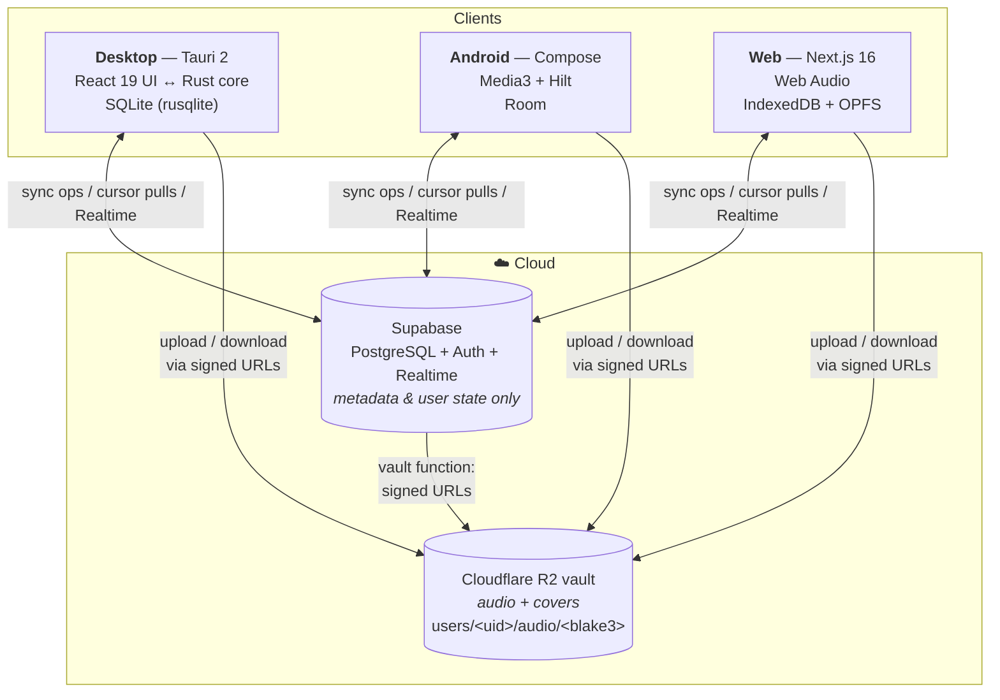
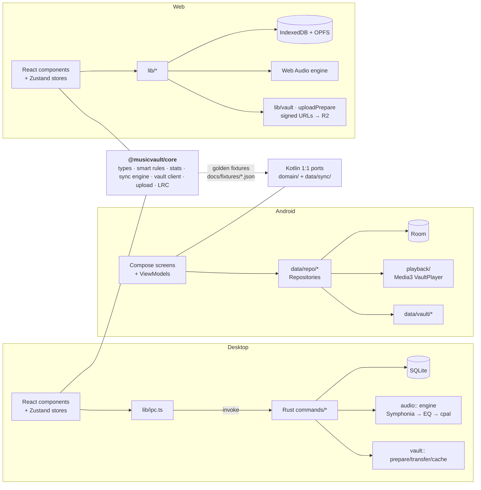
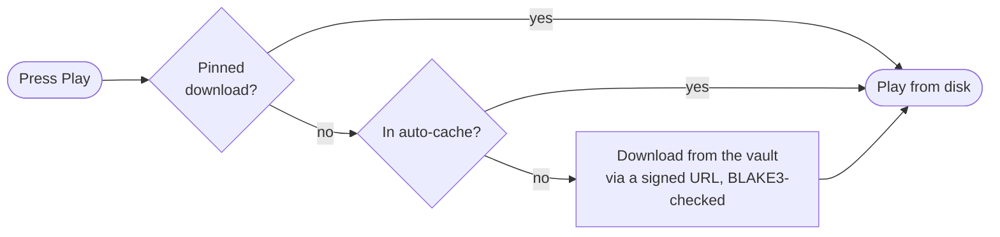
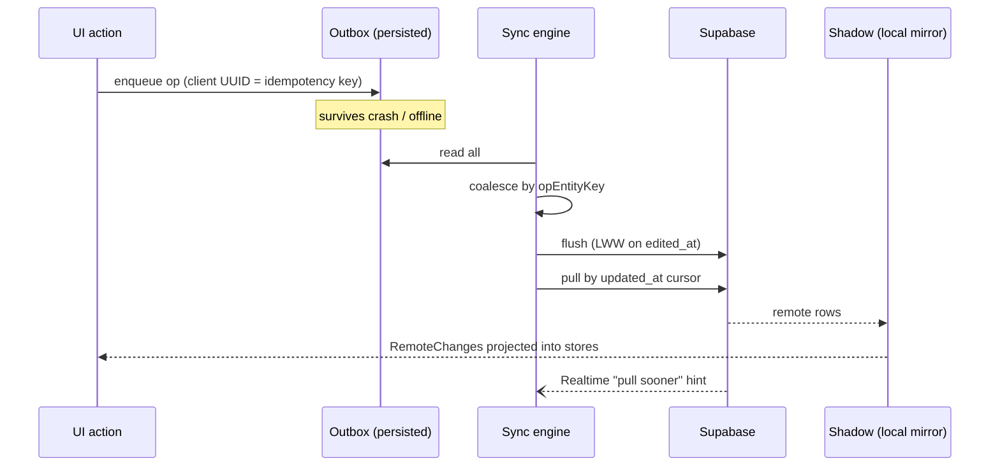

# MusicVault — Project Overview

> Audit date: 2026-07-17 · Repository state: branch `main` @ `e3b5237` · 45 commits (2026-07-14 → 2026-07-17);
> feature lists rechecked 2026-10-15 (star ratings removed 2026-10-13)
> Every claim below was verified against the files cited during this audit.

## 1. What the project is

MusicVault is a **personal music ecosystem for people who own their music files** — as
opposed to a streaming service. It is a monorepo containing three first-party clients that
share one account, one library, and one set of playlists, favorites and listening
history:

| Client | Technology | Manifest |
|---|---|---|
| **Desktop** (Windows) | Tauri 2, React 19, TypeScript, Tailwind 4; Rust audio engine | [apps/desktop/package.json](../apps/desktop/package.json), [apps/desktop/src-tauri/Cargo.toml](../apps/desktop/src-tauri/Cargo.toml) |
| **Android** | Kotlin 2.0, Jetpack Compose, Media3/ExoPlayer, Room, Hilt | [apps/android/app/build.gradle.kts](../apps/android/app/build.gradle.kts) |
| **Web** | Next.js 16 App Router, React 19, Web Audio API | [apps/web/package.json](../apps/web/package.json) |

Two cloud services back the clients, with a strict division of responsibility:

- **The vault** — a private Cloudflare R2 bucket holding each user's **audio and covers**. Bytes
  only, reached through short-lived pre-signed URLs from the `vault` Edge Function. See
  [VAULT.md](VAULT.md).
- **Supabase** (PostgreSQL + Auth + Realtime + Edge Functions) — the account, **every track's
  details** (edited online from any app) and all user state. Audio bytes never touch this
  database.

The product identity is declared in [apps/desktop/src-tauri/tauri.conf.json](../apps/desktop/src-tauri/tauri.conf.json)
(`productName: "Music Vault"`, `identifier: com.naimul.music-vault`, version `1.0.0`) and
[apps/android/app/build.gradle.kts](../apps/android/app/build.gradle.kts) (`applicationId
com.musicvault`, `versionName "1.0"`).

## 2. Architecture

### 2.1 System view

Source: client stacks per the manifests in §1; the vault layout and function are in
[supabase/functions/vault/](../supabase/functions/vault) — see [VAULT.md](VAULT.md).

### 2.2 Layered view (per client)

The shared TypeScript package is consumed directly by desktop and web
([packages/core/package.json](../packages/core/package.json) is a workspace of the root
[package.json](../package.json)); Android cannot consume TypeScript, so the same logic is
ported 1:1 to Kotlin and both implementations are pinned to the same golden fixtures
(`docs/fixtures/smart-rules.golden.json`, `docs/fixtures/stats.golden.json`,
`docs/fixtures/track-edit.golden.json`). See
[ARCHITECTURE_DECISIONS.md](ARCHITECTURE_DECISIONS.md#shared-logic-two-implementations-one-fixture-set).

## 3. Data flow

### 3.1 Playback resolution (the "audio never streams twice" rule)

The two-tier model — auto-cache (LRU-evicted under a size cap) and pinned downloads (never
auto-evicted) — is implemented in
[apps/desktop/src-tauri/src/vault/cache.rs](../apps/desktop/src-tauri/src/vault/cache.rs) and
mirrored on the other clients ([AudioCache.kt](../apps/android/app/src/main/java/com/musicvault/data/vault/AudioCache.kt),
[apps/web/src/lib/audioCache.ts](../apps/web/src/lib/audioCache.ts)). Details in
[VAULT.md](VAULT.md) and [FEATURES.md](FEATURES.md#caching).

### 3.2 Sync cycle

Two timestamps carry distinct roles, documented at
[supabase/migrations/0003_sync.sql:1-6](../supabase/migrations/0003_sync.sql): `updated_at`
(server trigger) drives pull cursors, `edited_at` (client-supplied) resolves last-writer-wins
conflicts. The op envelope and payload union live at
[packages/core/src/sync/types.ts:64-107](../packages/core/src/sync/types.ts). Full protocol:
[docs/sync-protocol.md](../docs/sync-protocol.md); API surface in [API.md](API.md).

### 3.3 Statistics

Statistics derive **entirely** from an append-only play-event stream — there is no play-count
column in Supabase, confirmed by the schema comment at
[supabase/migrations/0001_init.sql:208-212](../supabase/migrations/0001_init.sql) and the
absence of any such column in `public.tracks`. Each client writes every listening session to a
device-local log that deliberately survives sign-out (desktop SQLite `play_events`
[db/mod.rs:188-206](../apps/desktop/src-tauri/src/db/mod.rs); web IndexedDB `mv-stats`
[playEventLog.ts](../apps/web/src/lib/playEventLog.ts); Android Room `play_events`
[Entities.kt:94-103](../apps/android/app/src/main/java/com/musicvault/data/db/Entities.kt)) and
also enqueues a `playEvent.add` op under the *same* event id so merged sources dedupe.

> ⚠️ **Cross-platform discrepancy.** Android additionally keeps a `play_history` table with
> `playCount`/`listenSeconds`/`lastPlayedAt` aggregates
> ([Entities.kt:72-78](../apps/android/app/src/main/java/com/musicvault/data/db/Entities.kt)) that
> the other clients do not have. See [FEATURE_PARITY.md](FEATURE_PARITY.md).

## 4. Storage providers

| Provider | Role | Where implemented |
|---|---|---|
| Cloudflare R2 (the vault) | Audio and covers, named by content hash | [supabase/functions/vault/](../supabase/functions/vault), `vault/` (desktop), `data/vault/` (Android), `lib/vault.ts` + `lib/uploadPrepare.ts` (web) |
| Supabase Postgres | Track details, playlists, ratings, favorites, play events, settings, queue | [supabase/migrations/](../supabase/migrations) |
| Device DB | Offline-first local state | SQLite / Room / IndexedDB — see [DATABASE.md](DATABASE.md) |
| OPFS | Web audio cache bytes | [apps/web/src/lib/audioCache.ts](../apps/web/src/lib/audioCache.ts) |

**Track identity** is the linchpin that keeps one song from splitting into three: a track is
known by the **BLAKE3** hash of its audio, unique per user in Supabase `tracks`. The database
enforces that every live row has one —
`constraint tracks_identity check (deleted_at is not null or content_hash is not null)`
([0005_drop_drive.sql](../supabase/migrations/0005_drop_drive.sql)). Uploading a file whose hash
is already known attaches to that row, so history is never split. The client-side rule is encoded in
[`trackRefHasIdentity`](../packages/core/src/sync/types.ts) at
[sync/types.ts:25-27](../packages/core/src/sync/types.ts).

## 5. Implementation status

All ten phases (0–9) are marked complete in [README.md:74-110](../README.md), and the commit
history corroborates each one with a dedicated commit — see [PHASE_PROGRESS.md](PHASE_PROGRESS.md)
for the commit-by-commit derivation. The repository is at version `1.0.0` across the root
[package.json](../package.json), [Cargo.toml](../apps/desktop/src-tauri/Cargo.toml) and
[tauri.conf.json](../apps/desktop/src-tauri/tauri.conf.json) (Android reports `versionName "1.0"`,
`versionCode 1`).

Post-1.0 work on 2026-07-17 (13 commits after the Phase 9 docs commit `36e11d8`) is bug-fix and
polish: bounded-concurrency downloads, a jump-list startup crash fix, collapsible sidebar/account
menu, and queue-clear correctness across devices.

On 2026-10-11 to 13 the **vault migration** replaced Google Drive with the private R2 vault:
manual uploads from all three apps, details and covers edited online, delete from any app, and the
removal of Drive, local-folder libraries and local mode. The library was rebuilt from scratch
([docs/drive-to-r2-migration.md](../docs/drive-to-r2-migration.md)).

### Implemented

Library management, playback (three engines), the vault (upload, online editing, delete), two-tier caching,
favorites, playlists, smart playlists, Statistics 2.0, cross-device sync, settings, downloads,
authentication and the UI shell are all present on the platforms detailed in
[FEATURES.md](FEATURES.md), with the per-platform gaps enumerated in
[FEATURE_PARITY.md](FEATURE_PARITY.md).

### Planned / not implemented

Items found in the code as explicit future work rather than shipped behavior:

- 🚧 **WASAPI-Exclusive / ASIO output** — named as future work in
  [docs/architecture.md:30-32](../docs/architecture.md) and [PLAN.md:148-156](../PLAN.md), both of
  which describe the output as sitting "behind a trait" that these would slot into.
  ⚠️ **That trait does not exist**: `audio/output.rs` defines a concrete `Output` struct wrapping
  `cpal` directly (the only `trait` tokens in `audio/` are cpal's own imported traits). The
  swappability is a module boundary, not an abstraction — see
  [ARCHITECTURE_DECISIONS.md](ARCHITECTURE_DECISIONS.md#adr-011-replaceable-components-aspirational-in-two-places).
- 🚧 **Bundle targets beyond Windows NSIS** — `"targets": ["nsis"]`
  ([tauri.conf.json](../apps/desktop/src-tauri/tauri.conf.json)); macOS/Linux icons exist in
  `icons/` but no bundle target or CI job builds them.
- 🚧 **iOS** — icon assets exist under `src-tauri/icons/ios/` (generated by the Tauri icon tool);
  there is no iOS app, project, or build configuration anywhere in the repo.

See [ROADMAP.md](ROADMAP.md) for the full completed/in-progress/not-started breakdown.

## 6. Major technologies

**Desktop** — Tauri 2 · React 19.2 · TypeScript ~6.0 · Tailwind 4 · Zustand 5 · dnd-kit ·
lucide-react · Vite 8. Rust: `symphonia` (mp3/flac/wav/pcm/ogg/vorbis/isomp4/aac/alac),
`cpal`, `rubato`, `rustfft`, `biquad`, `lofty`, `souvlaki` (SMTC), `rusqlite` (bundled),
`reqwest` (rustls), `keyring` (windows-native), `blake3`, `notify`, `image`, `tracing`,
`ape-decoder`, plus vendored libwavpack C sources compiled by `build.rs`.

**Android** — Kotlin 2.0.21 · Compose BOM 2024.12.01 · Media3 1.5.1 · Room 2.6.1 · Hilt 2.53.1 ·
WorkManager 2.10 · AppAuth 0.11.1 · supabase-kt 3.0.3 · Ktor 3.0.3 · Coil · JAudioTagger ·
Timber · FFmpeg 6.0.1 (ape and wavpack decoders only, in the `:ffmpeg` module). `compileSdk`/`targetSdk` 35, `minSdk` 28, JDK 17.

**Web** — Next.js 16.1 · React 19.2 · `@supabase/ssr` · `idb` · `music-metadata` · Zustand ·
dnd-kit · Tailwind 4 · Playwright.

**Shared** — `@musicvault/core` (TypeScript, vitest) and its Kotlin ports.

## 7. Where to go next

| Question | Document |
|---|---|
| What's in each folder? | [REPOSITORY_STRUCTURE.md](REPOSITORY_STRUCTURE.md) |
| What can the app do, and where is it implemented? | [FEATURES.md](FEATURES.md) |
| What do the three schemas look like? | [DATABASE.md](DATABASE.md) |
| What is every public interface? | [API.md](API.md) |
| How do I build and run it? | [BUILD_AND_RUN.md](BUILD_AND_RUN.md) · [ENVIRONMENT_VARIABLES.md](ENVIRONMENT_VARIABLES.md) |
| How do uploads, editing and downloads work? | [VAULT.md](VAULT.md) |
| Why is it built this way? | [ARCHITECTURE_DECISIONS.md](ARCHITECTURE_DECISIONS.md) |
| Does feature X work on platform Y? | [FEATURE_PARITY.md](FEATURE_PARITY.md) |
