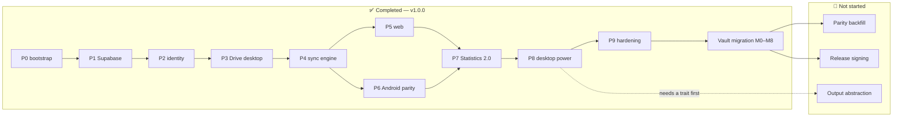
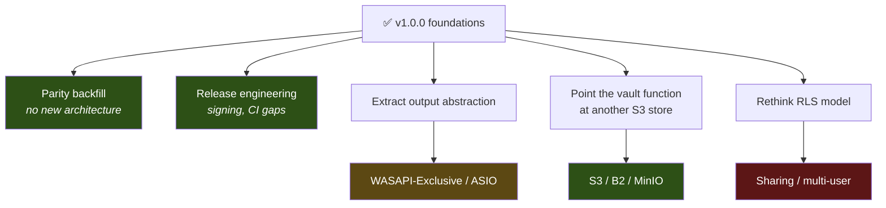

# Roadmap

> Audit date: 2026-07-17 · branch `main` @ `e3b5237`; updated 2026-10-13 after the vault
> migration.
> **Completed** is derived from the code and commit history ([PHASE_PROGRESS.md](PHASE_PROGRESS.md)).
> **Not Started / Future** items are either named as future work in [PLAN.md](../PLAN.md) or are
> gaps this audit found in the code. Nothing here is a commitment — the repository has no issue
> tracker, no TODO backlog, and no milestone file beyond PLAN.md.

## Status at a glance

v1.0.0 is **complete**: all ten planned phases shipped between 2026-07-14 and 2026-07-17. The
largest change since is the **vault migration** (2026-10-11 to 13, steps M0–M8): Google Drive,
local-folder libraries and local mode were replaced by a private Cloudflare R2 vault with manual
uploads, online editing and delete from every app
([docs/drive-to-r2-migration.md](../docs/drive-to-r2-migration.md)).

---

## ✅ Completed

All of Phases 0–9 and the vault migration — see [PHASE_PROGRESS.md](PHASE_PROGRESS.md) for the
commit-level table. In capability terms:

| Area | State |
|---|---|
| Library (upload, online editing, delete, browse, search) | All three |
| Playback (3 engines, gapless, crossfade, EQ, visualizer, lyrics) | All three |
| The vault (R2 + `vault` function, signed URLs, verified downloads) | All three |
| Two-tier cache | All three |
| Ratings, favorites, playlists, smart playlists | All three |
| Statistics 2.0 | All three (recap: desktop + web) |
| Cross-device sync | All three |
| Auth (account required) | All three |
| Desktop power features (mini player, tray, jump list, ReplayGain) | Desktop |
| CI + release builds | GitHub Actions |
| Docs (setup, vault setup, architecture, sync protocol, `/help`) | Shipped |

---

## 🔄 In Progress

**Nothing.** The vault migration is finished (M8, docs, was its last step). The library is being
rebuilt by uploading songs, which is the owner's task, not code.

The nearest thing to unfinished work is **dead code**: Android's recap engine is fully ported
(`Stats.Recap`, `computeRecap`, `recapYears` at
[Stats.kt:380-458](../apps/android/app/src/main/java/com/musicvault/domain/Stats.kt)) but no screen
references it. The engine is done; only the UI is missing.

---

## 🚧 Not Started

Ordered by the ratio of user value to effort, as this audit reads it.

### 1. Cross-platform parity backfill
The largest coherent body of work. Every item is a gap in
[FEATURE_PARITY.md](FEATURE_PARITY.md); none needs new architecture.

| Item | Platform | Effort | Notes |
|---|---|---|---|
| **Recap screen** | Android | **Small** | Engine already ported and golden-tested — pure UI work |
| **ReplayGain application** | Android, web | Medium | Values are stored on the track row; only application is missing |
| **ReplayGain on Android uploads** | Android | Small | JAudioTagger has no ReplayGain FieldKey, so a phone upload carries none |
| **"Download all"** | Android, web | Small | Desktop's Downloads view has it |
| **Verify Android's streaming cache** | Android | Medium | Pinned downloads are BLAKE3-checked; Media3's streaming cache isn't |
| **Replace a track's audio** | All | Medium | Swap in a better file while keeping the row's history — today: upload the new file, delete the old |
| **Custom hex accents** | Android | Small | Currently falls back to the default accent |
| **Playlist folders** | All | Medium | ⚠️ **Schema-ready, UI-less on every client**: Supabase has `is_folder`/`parent_id` and the sync snapshot carries them, but desktop's `playlists` table has no such columns. Half-built since Phase 1 |

**Dependencies**: none — all build on shipped foundations.

### 2. Release engineering
| Item | Effort | Notes |
|---|---|---|
| **Android release signing** | Small | ⚠️ CI ships a **debug-signed** APK; "Play-store signing is out of scope for v1" ([release.yml](../.github/workflows/release.yml)). No signing config exists in Gradle |
| **Release-build verification in CI** | Small | CI never builds `assembleRelease`, so the minify/shrink path is untested — a classic source of "debug works, release crashes" ([TROUBLESHOOTING.md](TROUBLESHOOTING.md#release-build-crashes-but-debug-works)) |
| **RLS/schema checks in CI** | Medium | ⚠️ The authorization layer and the vault schema are verified by manual scripts ([TESTING.md §6](TESTING.md#6-supabase-sql-and-the-vault--manual)) |
| **Room migration tests** | Small | Desktop asserts its risky migrations; Room has none, and `exportSchema = false` removes the usual safety net |

### 3. Audio output backends — WASAPI Exclusive / ASIO
Named as future work in [PLAN.md:261](../PLAN.md) and [docs/architecture.md:30-32](../docs/architecture.md).

⚠️ **Both documents describe a trait that does not exist.** `audio/output.rs` defines a concrete
`Output` struct over `cpal` ([ARCHITECTURE_DECISIONS.md ADR-011](ARCHITECTURE_DECISIONS.md#adr-011-replaceable-components-aspirational-in-two-places)).
**Dependency**: extract the abstraction first. Effort is **Large**, not the "slot in later" the plan
implies.

### 4. Another storage provider
[PLAN.md](../PLAN.md) listed "Additional storage providers behind the Drive client interface"; the
vault replaced that idea. Storage now sits behind one Edge Function speaking the S3 API, and
objects are named by content hash, so moving to another S3-compatible store (S3, B2, MinIO) is a
change of endpoint and secrets plus a bucket copy — no client or schema change. Effort: **Small**.
A non-S3 provider would need a second signer in the function. Not planned.

### 5. Multiple users / library sharing
[PLAN.md:262](../PLAN.md). ⚠️ Every RLS policy is `user_id = auth.uid()` and the schema has no
sharing concept. **Dependency**: a fundamental rethink of ADR-018. Effort: **Very large** — this is
a different product.

### 6. Other platforms
| Item | Evidence |
|---|---|
| **macOS / Linux desktop** | 🚧 Icons exist (`icon.icns`) but `"targets": ["nsis"]` is the only bundle target, and `smtc.rs`/`jumplist.rs` are Windows-specific. Tauri makes it possible; the code currently doesn't |
| **iOS** | 🚧 `src-tauri/icons/ios/` exists (generated by Tauri's icon tool) but there is **no iOS project, target, or config** anywhere. The icons are an artifact of the tooling, not evidence of intent |

---

## 💡 Future Ideas

Not in PLAN.md — implied by the architecture and offered as candidates:

- **Clock-skew defense for LWW.** `edited_at` is a client clock and nothing detects skew
  ([ADR-005](ARCHITECTURE_DECISIONS.md#adr-005-two-timestamps-updated_at-for-cursors-edited_at-for-lww)).
  A server-side sanity clamp would harden the one place correctness depends on device honesty.
- **Retire Android's `play_history` table.** It predates Phase 7 and contradicts ADR-008's
  "no play-count column anywhere". Deriving it from `play_events` would remove a whole class of
  divergence.
- **Fixture-link the sync engines.** Rules and stats are pinned across languages; the sync engines —
  the most complex shared logic — have parallel hand-written suites instead
  ([TESTING.md](TESTING.md#the-sync-engine-suite-765-lines-is-the-crown-jewel)). A shared
  op/expectation fixture would close the gap.
- **`play_events` compaction.** Append-only + soft state means unbounded growth. Fine for years of
  personal use; eventually a pull cursor's first sync gets expensive.
- **A shared player abstraction.** The queue-clear bug needed three commits across three clients
  (`5423e5b`, `f381eb5`, `a1247c0`). Queue/shuffle/repeat semantics are pure logic and could join
  `@musicvault/core` — Android already has 14 `QueueStateTest` cases proving the logic is separable.
- **Supabase migration runner.** Migrations are applied by hand
  ([BUILD_AND_RUN.md §6](BUILD_AND_RUN.md#6-supabase)); nothing verifies a project matches the repo.
- **Coverage measurement.** No tooling is configured in any language ([TESTING.md §7](TESTING.md#7-coverage)).

---

## Dependency summary

The honest summary: **v1 is done and the cheap wins are all parity work.** Everything the original
plan filed under "future" turns out to need an abstraction built first — the plan assumed those
abstractions already existed, and they don't.
