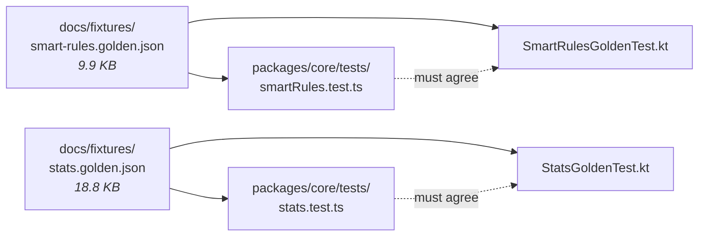

# Testing

> Audit date: 2026-07-17 · branch `main` @ `e3b5237`; counts and suites updated 2026-10-13 for
> the vault. Suites: core vitest, the `vault` function's vitest, desktop/web vitest, Rust
> `cargo test`, Android JVM, Playwright web e2e, and manual SQL smoke tests. CI wiring:
> [BUILD_AND_RUN.md §9](BUILD_AND_RUN.md#9-cicd).

## Run everything

```sh
npm run core:test                                    # vitest — 160 tests, 10 files
npm run vault:test                                   # vitest — 23 tests, the vault function
npm run desktop:test                                 # vitest — 4 tests (library projection)
npm run web:test                                     # vitest — 4 tests (vault helpers)
cd apps/desktop/src-tauri && cargo test              # Rust — 15 tests, 5 modules
cd apps/android && ./gradlew.bat testDebugUnitTest   # Kotlin JVM — 82 cases, 9 files
npm run web:e2e                                      # Playwright — 2 specs
```

## Inventory

| Suite | Runner | Files | Cases | Location |
|---|---|---:|---:|---|
| Core | vitest 3 | 10 | 160 | [packages/core/tests/](../packages/core/tests) |
| Vault function | vitest | 1 | 23 | [supabase/functions/vault/handler.test.ts](../supabase/functions/vault/handler.test.ts) |
| Desktop / web | vitest | 1 + 1 | 4 + 4 | [vaultMerge.test.ts](../apps/desktop/src/lib/vaultMerge.test.ts), [vaultWeb.test.ts](../apps/web/src/lib/vaultWeb.test.ts) |
| Rust | cargo | 5 modules | 15 | inline `#[cfg(test)]` in `src-tauri/src/` |
| Android | JUnit 4 + Truth | 9 | 82 | [app/src/test/java/com/musicvault/](../apps/android/app/src/test/java/com/musicvault) |
| Web e2e | Playwright | 2 | — | [apps/web/e2e/](../apps/web/e2e) |
| Supabase SQL | psql, manual | 3 | — | [rls_smoke.sql](../supabase/tests/rls_smoke.sql), [vault_smoke.sql](../supabase/tests/vault_smoke.sql), [track_edit_golden.mjs](../supabase/tests/track_edit_golden.mjs) |
| Vault end to end | node, manual | 1 | — | [functions/vault/smoke.mjs](../supabase/functions/vault/smoke.mjs) — against the real bucket |

There are **no** unit tests for React components, Zustand stores, Compose UI, or the Android
repositories/ViewModels. Testing effort is concentrated where correctness is subtle: sync conflict
resolution, rule evaluation, stats aggregation, and cache eviction.

---

## 1. The strategy: golden fixtures pin two implementations

This is the project's central testing idea. Android cannot consume TypeScript, so `smartRules.ts`
and `stats.ts` have hand-written Kotlin ports — and **shared JSON fixtures are what stop them
drifting**.



Both sides load the **same file** from `docs/fixtures/` — TypeScript via
`readFileSync(new URL("../../../docs/fixtures/smart-rules.golden.json", import.meta.url))`
([smartRules.test.ts:22-23](../packages/core/tests/smartRules.test.ts)), Kotlin from
`SmartRulesGoldenTest`.

The fixture states its own contract in a `$comment` field
([docs/fixtures/smart-rules.golden.json:2](../docs/fixtures/smart-rules.golden.json)):

> "Golden test cases for the smart-rules engine. Consumed by
> packages/core/tests/smartRules.test.ts (TypeScript) and apps/android SmartRulesGoldenTest
> (Kotlin). `now` is fixed for determinism; timestamps are epoch ms; duration is seconds; rating
> 0/absent = unrated. **Do not change semantics in one engine without updating the other AND these
> fixtures.**"

Determinism comes from pinning the clock (`"now": 1752400000000`) and, for stats, the timezone
(`offsetMinutes` → `fixedOffsetZone`, [stats.test.ts:51](../packages/core/tests/stats.test.ts)) —
which is why `StatsZone` is pluggable at all
([core/stats.ts:47-51](../packages/core/src/stats.ts)).

**If you change rule or stats semantics, three things move together**: the TypeScript, the Kotlin,
and the fixture. See [DEVELOPER_GUIDE.md](DEVELOPER_GUIDE.md#changing-shared-logic).

---

## 2. Core suite — [packages/core/tests/](../packages/core/tests)

| File | Cases | Covers |
|---|---:|---|
| [syncEngine.test.ts](../packages/core/tests/syncEngine.test.ts) | 28 | The conflict surface (below), including `track.edit` and paged pulls |
| [upload.test.ts](../packages/core/tests/upload.test.ts) | 13 | Upload drafts, batch fields, cover rules, `uploadTrack` (new, known, revived, already stored) |
| [trackFields.test.ts](../packages/core/tests/trackFields.test.ts) | 12 | Track edits + **golden fixture** (`track-edit.golden.json`) |
| [vault.test.ts](../packages/core/tests/vault.test.ts) | 10 | Vault client, `SignedUrlCache`, `deletedVaultHashes` |
| [lrc.test.ts](../packages/core/tests/lrc.test.ts) | 7 | LRC parsing |
| [fractional.test.ts](../packages/core/tests/fractional.test.ts) | 6 | Fractional index keys |
| [smartPlaylists.test.ts](../packages/core/tests/smartPlaylists.test.ts) | 6 | Built-in smart playlists |
| [stats.test.ts](../packages/core/tests/stats.test.ts) | 6 | Stats engine + **golden fixture** |
| [smartRules.test.ts](../packages/core/tests/smartRules.test.ts) | 5 | Rule engine + **golden fixture** |
| [format.test.ts](../packages/core/tests/format.test.ts) | 4 | Formatting |

The table counts `it` blocks (97); vitest reports 160 because the golden-fixture tests expand
into one test per fixture case.

### The sync engine suite (765 lines) is the crown jewel

It is testable without a network because `SyncEngine` takes an injected transport and storage —
"both injectable, so the whole conflict surface is testable without a network"
([core/sync/engine.ts:65-68](../packages/core/src/sync/engine.ts)) — plus injectable `now`/`uuid`
and `autoSync: false` so tests drive `syncNow()` deterministically
([:28-41](../packages/core/src/sync/engine.ts)). `MemorySyncStorage`
([core/sync/storage.ts:39](../packages/core/src/sync/storage.ts)) is the in-memory storage.

The case names read as a specification of the sync protocol:

| Scenario | Case |
|---|---|
| Track creation | "flushes a favorite and creates the canonical track row on demand" ([:345](../packages/core/tests/syncEngine.test.ts)) |
| Convergence | "two devices favoriting the same unpublished track converge on one row" ([:357](../packages/core/tests/syncEngine.test.ts)) |
| Idempotency | "replaying an already-pushed op is idempotent" ([:366](../packages/core/tests/syncEngine.test.ts)) |
| LWW | "rating conflict: the later edit wins **regardless of flush order**" ([:381](../packages/core/tests/syncEngine.test.ts)) |
| Coalescing | "outbox coalesces repeated edits of the same entity" ([:395](../packages/core/tests/syncEngine.test.ts)) |
| Queue clear | "an empty queue.set clears the handoff row and reaches the other device" ([:404](../packages/core/tests/syncEngine.test.ts)) — added for the `a1247c0` bug |
| Offline | "offline: ops queue, survive, and flush on reconnect" ([:438](../packages/core/tests/syncEngine.test.ts)) |
| Diagnostics | "breadcrumbs trace drops, cycles, coalescing, offline and lost conflicts" ([:454](../packages/core/tests/syncEngine.test.ts)) |
| Pull safety | "pull does not clobber a newer pending local edit" ([:509](../packages/core/tests/syncEngine.test.ts)) |
| Resurrection | "playlist delete vs later rename: the rename resurrects the playlist" ([:529](../packages/core/tests/syncEngine.test.ts)) |
| Ordering merge | "concurrent reorder + add merge: both intents survive" ([:595](../packages/core/tests/syncEngine.test.ts)) |
| Item LWW | "a remove never undoes a concurrent add" ([:635](../packages/core/tests/syncEngine.test.ts)); "re-adding beats an older remove" ([:661](../packages/core/tests/syncEngine.test.ts)) |
| Settings | "settings sync per key with LWW" ([:681](../packages/core/tests/syncEngine.test.ts)) |
| Handoff | "queue handoff: LWW single row, identities mapped on pull" ([:694](../packages/core/tests/syncEngine.test.ts)) |
| Append-only | "play events are append-only and replay-idempotent" ([:716](../packages/core/tests/syncEngine.test.ts)); "distinct play events never coalesce" ([:739](../packages/core/tests/syncEngine.test.ts)) |
| Guard rail | "drops ops whose track ref has no durable identity" ([:754](../packages/core/tests/syncEngine.test.ts)) — the `trackRefHasIdentity` rule |

The Kotlin port has its **own 26-case translation** of this suite
([SyncEngineTest.kt](../apps/android/app/src/test/java/com/musicvault/data/sync/SyncEngineTest.kt),
655 lines) — commit `8c0ddd9` describes it as a "full test suite". The two suites are not fixture-
linked (unlike rules/stats); they are parallel implementations of the same scenarios.

---

## 3. Rust suite — 15 tests

Inline `#[cfg(test)]` modules in five files:

| Module | Tests |
|---|---|
| [vault/cache.rs](../apps/desktop/src-tauri/src/vault/cache.rs) | `enforce_cap_evicts_least_recently_used_first_and_spares_pinned` · `resolve_bumps_recency_so_played_tracks_survive_eviction` · `resolve_cleans_up_index_rows_for_vanished_files` · `register_download_pinned_skips_cap_and_promote_moves_tiers` · `forgets_cached_copies_of_deleted_tracks` |
| [vault/prepare.rs](../apps/desktop/src-tauri/src/vault/prepare.rs) | `covers_are_square_capped_and_named_by_their_sha256` · `small_covers_are_never_upscaled` · `the_same_image_always_gets_the_same_name` · `unreadable_images_are_rejected` · `hashes_match_independent_computation_and_formats_are_checked` |
| [db/mod.rs](../apps/desktop/src-tauri/src/db/mod.rs) | `fresh_db_migrates_to_latest_without_drive_or_folder_tables` · `upgrading_from_v8_clears_the_old_library_and_keeps_settings` |
| [audio/decoder.rs](../apps/desktop/src-tauri/src/audio/decoder.rs) | `decodes_hires_wav_at_native_rate` · `missing_file_reports_not_found` |
| [audio/output.rs](../apps/desktop/src-tauri/src/audio/output.rs) | `plays_hires_tone_through_default_device` |

The cache tests (Phase 9a, `c889289`, plus the vault's `forgets_…`) each name an invariant rather
than a function — pinned files survive eviction, playing a track refreshes its recency, a vanished
file self-heals its index row, pinning skips the cap and promotion moves tiers without
re-downloading, and copies of deleted tracks go.

The DB tests assert the riskiest migration: that v9 reaches the latest schema with no Drive or
folder tables, and that upgrading a populated v8 database clears the old library but keeps the
device settings.

### ⚠️ Two environment-sensitive tests

- **`plays_hires_tone_through_default_device`** needs a real audio device. CI runs
  `cargo test -- --skip plays_hires_tone_through_default_device` because "CI runners have no audio
  output device" ([ci.yml](../.github/workflows/ci.yml)). It runs locally.
- **All of them need the frontend dist to exist first** — `tauri::generate_context!` embeds it at
  compile time, so CI runs `npm run build -w music-vault-desktop` before `cargo test`. Running
  `cargo test` in a clean checkout without that step **fails to compile**.

The DB tests write to `std::env::temp_dir()` keyed by process id
([db/mod.rs:261](../apps/desktop/src-tauri/src/db/mod.rs)) rather than using a temp-dir crate.

---

## 4. Android suite — 82 cases

| File | Cases | Covers |
|---|---:|---|
| [SyncEngineTest.kt](../apps/android/app/src/test/java/com/musicvault/data/sync/SyncEngineTest.kt) | 26 | Kotlin conflict suite (mirrors §2) |
| [VaultMergeTest.kt](../apps/android/app/src/test/java/com/musicvault/data/vault/VaultMergeTest.kt) | 6 | The library projection (rows, pending edits, favorites, ratings, covers) |
| [TrackEditGoldenTest.kt](../apps/android/app/src/test/java/com/musicvault/data/sync/TrackEditGoldenTest.kt) | 4 | **Golden fixture** (`track-edit.golden.json`) |
| [QueueStateTest.kt](../apps/android/app/src/test/java/com/musicvault/playback/QueueStateTest.kt) | 14 | Queue/shuffle/repeat — Android-only logic |
| [SmartPlaylistsTest.kt](../apps/android/app/src/test/java/com/musicvault/domain/SmartPlaylistsTest.kt) | 12 | Built-in smart playlists |
| [FractionalTest.kt](../apps/android/app/src/test/java/com/musicvault/data/sync/FractionalTest.kt) | 6 | Fractional keys (mirrors `fractional.test.ts`, same count) |
| [StatsGoldenTest.kt](../apps/android/app/src/test/java/com/musicvault/domain/StatsGoldenTest.kt) | 5 | **Golden fixture** |
| [LrcTest.kt](../apps/android/app/src/test/java/com/musicvault/domain/LrcTest.kt) | 5 | LRC parsing |
| [SmartRulesGoldenTest.kt](../apps/android/app/src/test/java/com/musicvault/domain/SmartRulesGoldenTest.kt) | 4 | **Golden fixture** |

JVM-only (JUnit 4 + Truth + `kotlinx-coroutines-test`,
[build.gradle.kts:112-114](../apps/android/app/build.gradle.kts)). There are **no instrumented
tests**: `testInstrumentationRunner` is declared
([build.gradle.kts:22](../apps/android/app/build.gradle.kts)) but no `androidTest` source set
exists, and CI states the constraint — "Android unit tests (JVM only — no emulator on CI)"
([ci.yml](../.github/workflows/ci.yml)). Room migrations are therefore **not** migration-tested
(unlike desktop's SQLite).

---

## 5. Web e2e — Playwright

Two tiers, by design ([playwright.config.ts:5-13](../apps/web/playwright.config.ts)):

| Spec | Runs |
|---|---|
| [unauthenticated.spec.ts](../apps/web/e2e/unauthenticated.spec.ts) | **Always** — route protection, login form, the proxy's 401 for `/api/*`; works against dummy Supabase env |
| [authenticated.spec.ts](../apps/web/e2e/authenticated.spec.ts) | Only with `E2E_EMAIL` + `E2E_PASSWORD`; otherwise `test.skip(…, "E2E_EMAIL / E2E_PASSWORD not set")` ([:14](../apps/web/e2e/authenticated.spec.ts)) |

Config notes:
- **Port 3100**, not 3000 — `webServer: "npm run dev -- --port 3100"`, so e2e never collides with a
  dev server you already have running (`reuseExistingServer: !CI`).
- `fullyParallel: false`, `workers: 1` — "authenticated specs share one account — keep them serial"
  ([:26](../apps/web/playwright.config.ts)).
- Dummy Supabase env is injected **only** when there's no `.env.local` and no
  `NEXT_PUBLIC_SUPABASE_URL` ([:15-24](../apps/web/playwright.config.ts)), so local runs use your
  real project and CI boots on dummies.
- `retries: 2` and `reporter: "github"` on CI; `trace: "on-first-retry"`.

---

## 6. Supabase SQL and the vault — manual

- [supabase/tests/rls_smoke.sql](../supabase/tests/rls_smoke.sql) — run in the SQL editor (or
  psql). Creates two users, asserts A sees exactly 1 track, B sees 0, and B cannot insert a row
  owned by A (expecting `insufficient_privilege` or `check_violation`), then `rollback`s.
- [supabase/tests/vault_smoke.sql](../supabase/tests/vault_smoke.sql) — the vault schema: the
  protected-column trigger, `apply_track_edit`, `resolve_upload_target`, `merge_tracks`,
  `delete_track`; rolls back.
- [supabase/tests/track_edit_golden.mjs](../supabase/tests/track_edit_golden.mjs) — runs the
  track-edit golden fixture against the live `apply_track_edit`, so SQL, TypeScript and Kotlin are
  pinned to the same cases.
- [supabase/functions/vault/smoke.mjs](../supabase/functions/vault/smoke.mjs) — end to end against
  the deployed function and the real bucket (you sign in; it cleans up after itself).

⚠️ **None of these run in CI** — they need a real project. CI covers the function's logic through
`handler.test.ts` (fakes for Supabase and R2), not the deployed function or the live schema.

---

## 7. Coverage

**No coverage tooling is configured anywhere** — no `@vitest/coverage-*` dependency, no
`--coverage` flag in any script, no JaCoCo, no `cargo-tarpaulin`. Coverage is not measured, and no
thresholds are enforced.

Qualitatively:

| Area | Coverage |
|---|---|
| Sync conflict semantics | 🟢 Excellent (28 TS + 26 Kotlin cases) |
| Track edits | 🟢 Excellent — one golden fixture across SQL, TypeScript and Kotlin |
| Vault function logic | 🟢 Good (23 cases with fakes); live behaviour by the manual smoke test |
| Upload flow | 🟢 Good in core (`uploadTrack`); platform file preparation thinly (Rust covers/hash only) |
| Smart rules / stats | 🟢 Excellent, and cross-language pinned |
| Cache LRU / tiers | 🟢 Good (5 invariant tests) |
| SQLite migrations | 🟢 Good (the v9 reset asserted) |
| Audio decode | 🟡 Thin (2 tests) |
| Queue logic | 🟡 Android only (14 cases); desktop/web queue logic untested |
| Web UI | 🟡 e2e smoke only |
| Room migrations | 🔴 None |
| Repositories / stores / components | 🔴 None |
| RLS + Supabase schema | 🔴 Not in CI (manual smoke tests) |
| Byte transfers to R2 (desktop Rust, web, Android) | 🔴 None in CI (network-dependent); the manual smoke test covers the protocol |

The pattern is deliberate and defensible: **pure logic is tested exhaustively; I/O boundaries are
not tested at all.** The sync engine is the exception that proves the rule — it was designed with
injectable ports precisely so its logic could be lifted out of the I/O.

## 8. Adding tests

- **Shared logic** → `packages/core/tests/*.test.ts`; if it has a Kotlin port, update the port and
  the golden fixture in the same commit.
- **Rust** → an inline `#[cfg(test)] mod tests` next to the code; name the test after the invariant,
  as the cache tests do.
- **Android** → `app/src/test/java/…`; JVM-only, no Android framework dependencies.
- **Web flows** → `apps/web/e2e/`; put anything needing an account behind the `E2E_EMAIL` skip.

See [DEVELOPER_GUIDE.md](DEVELOPER_GUIDE.md#how-to-write-tests).
